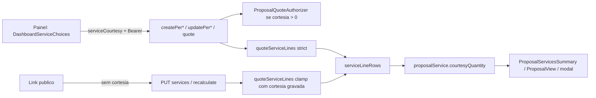

# Design — Cortesia de servicos no orcamento

## Visao geral da solucao

A cortesia e um inteiro na propria linha (`ProposalService.courtesyQuantity`). `quoteServiceLines` continua sendo a unica conta da linha e passa a descontar a cortesia. Os fluxos do dono enviam `serviceCourtesy`, e a criacao e a edicao conferem permissao no espaco quando ha cortesia. Os fluxos publicos nunca leem cortesia do corpo: conservam a gravada e a reduzem quando a quantidade cai. O frontend so pede a cortesia no painel e a exibe no painel e no link.



## Componentes e modulos impactados

- `backend`:
  - `prisma/schema.prisma` e `prisma/migrations/20261110190000_add_proposal_service_courtesy/migration.sql`;
  - `src/functions/quote-service-lines.ts`;
  - Zod de criar, editar e cotar em `src/zod/proposal/`;
  - controllers e use cases `create-proposal-per-person`, `create-proposal-per-day`, `update-proposal-per-person`, `update-proposal-per-day` e `quote-proposal`;
  - `update-public-proposal-services` e `recalculate-public-proposal`;
  - `serviceLineRows` em `proposal-in-prisma-repository.ts`;
  - factories de criar e editar, que ganham o `ProposalQuoteAuthorizer`.
- `frontend`:
  - `components/proposal/DashboardServiceChoices.tsx`;
  - `forms/PerPersonProposalForm.tsx`, `forms/PerDayProposalForm.tsx` e `pages/ProposalEdit.tsx`;
  - `lib/proposal-quote-input.ts`;
  - `lib/service-courtesy.ts` (novo);
  - `lib/service-price-label.ts`;
  - `components/proposal/ProposalServicesSummary.tsx`, `pages/ProposalView.tsx` e `components/proposal/UpdateProposalServicesDialog.tsx`;
  - `types/proposal.ts` e `services/proposal.service.ts`.

## Reuso previsto

- `quoteServiceLines`, `sumServiceQuote` e o formato de `serviceHoursMap`
- `ProposalQuoteAuthorizer` (mesmas permissoes de `/quote`)
- `readOptionalUserId` nas rotas publicas de criacao; `req.user.id` de `ensureAuthenticate` na edicao
- `HttpForbiddenError`, `HttpTokenError` e `HttpBadRequestError`
- estado e validacao de horas que os forms do painel ja tem (`serviceHoursInput`, `chosenServiceHours`)

## Contratos e dados

Banco:

```sql
ALTER TABLE `proposalService` ADD COLUMN `courtesyQuantity` INTEGER NOT NULL DEFAULT 0;
```

Corpo novo e opcional em `createPerPerson`, `createPerDay`, `updatePerPerson` (`data`), `updatePerDay` (`data`) e `quote`:

```ts
serviceCourtesy?: { serviceId: string; quantity: number }[] // max 100; quantity int 0..100000
```

Funcao:

- `serviceCourtesyMap(entries)`:
  - devolve `Record<string, number>`;
  - recusa id repetido ou valor que nao seja inteiro de 0 a 100000, com `COURTESY_MESSAGE`;
  - valida a forma por conta propria, porque o controller de `createPerPerson` nao aplica o Zod.
- `hasCourtesy(map)`: verdadeiro se algum valor for maior que 0.
- `quoteServiceLines` ganha `courtesyByServiceId?: Record<string, number>` e `courtesyMode?: "strict" | "clamp"` (padrao `strict`):
  - a quantidade continua saindo de `quantityFor`;
  - a cortesia vem do mapa, ou 0;
  - em `strict`, cortesia acima da quantidade lanca `HttpBadRequestError(COURTESY_MESSAGE)`;
  - em `clamp`, a cortesia vira `min(cortesia, quantidade)`;
  - `ServiceQuoteLine` ganha `courtesyQuantity: number`;
  - `amount = unitPrice * (quantity - courtesyQuantity)`.
- `COURTESY_MESSAGE = "Informe uma cortesia inteira, de 0 até a quantidade do serviço."`

Autorizacao:

- criacao: os controllers passam `authUserId: readOptionalUserId(req)` ao use case;
- edicao: os controllers passam `(req as AuthenticatedRequest).user.id`;
- o use case chama `authorizer.assert(authUserId, venueId)` antes de gravar, so quando `hasCourtesy`;
- na negativa, o `console.error` e a mensagem 403 sao proprios da cortesia ("Você não tem permissão para dar cortesia neste espaço."). Para isso, o `assert` ganha um parametro opcional de mensagem, ou a cortesia usa um wrapper fino;
- o `userId` do corpo continua servindo so para o historico.

Repositorio: `serviceLineRows` grava `courtesyQuantity: line.courtesyQuantity ?? 0`. O caminho legado sem linhas nao muda.

Link publico:

- `GET /presentation/:id/services`:
  - cada item ganha `courtesyQuantity` (o gravado, ou 0 se nao estiver selecionado);
  - cada item ganha `courtesyAmount` (unitario gravado x cortesia, ou 0);
  - segue sem `unitPrice` e `pricingType`.
- `PUT /presentation/:id/services`:
  - o Zod publico nao ganha o campo;
  - linha existente: `courtesyQuantity = existing.courtesyQuantity ?? 0`;
  - no `PER_HOUR`, aplica `min(cortesia, horas novas)` e `amount = unitPrice * (horas - cortesia)`;
  - nas outras linhas existentes, o `amount` gravado ja e liquido e segue igual;
  - linha nova sai da cotacao com cortesia 0;
  - `oldSum` e `newSum` ja usam o `amount` liquido;
  - os itens da resposta ganham `courtesyQuantity` e `courtesyAmount`.
- `recalculate`:
  - monta `courtesyByServiceId` com as linhas gravadas que tem cortesia acima de 0;
  - chama `quoteServiceLines` com `courtesyMode: "clamp"`;
  - o `PER_PERSON` passa a respeitar os convidados novos.

Frontend:

- `lib/service-courtesy.ts`:
  - `courtesyAmount(line)`, `fullServiceAmount(line)` e `courtesyLabel(line)`;
  - textos: "Cortesia: 2h (-R$ 100,00)", "Cortesia: 10 pessoas (-R$ ...)" e "Cortesia (-R$ ...)";
  - `courtesyFieldError(raw, max)` e `chosenServiceCourtesy(...)`, que devolvem `{ serviceCourtesy, errors }` no formato de `chosenServiceHours`.
- `quotedServiceDetail`: continua descrevendo o valor cheio (`unitario x quantidade`).
- `applyPublicServices` em `ProposalView`:
  - usa `courtesyQuantity` da resposta;
  - deixa de calcular `unitPrice = amount / hours` quando ha cortesia; conserva o `unitPrice` existente ou o deriva de `(amount + courtesyAmount) / hours`.

## Falhas, casos de borda e invariantes

- Invariante: `0 <= courtesyQuantity <= quantity` em toda linha gravada, e `amount >= 0`.
- A cortesia nunca vem de rota publica. A unica fonte e um corpo autenticado e autorizado.
- O campo de cortesia aparece so em servico marcado, fora do `label` do checkbox.
- O maximo do campo e dinamico: horas digitadas no `PER_HOUR`, convidados no `PER_PERSON`, 1 no `FIXED`.
- Mudar horas ou convidados no form para baixo da cortesia ja digitada mostra o erro no campo. A tela nao reduz sozinha; o servidor so reduz nos fluxos publicos.
- Campo vazio vale 0.
- Falha HTTP nao limpa os campos.
- Linha com cortesia total continua listada, valendo R$ 0,00.

## Decisoes arquiteturais importantes

- Cortesia na linha (`courtesyQuantity`). Descartados:
  - `courtesyAmount` gravado, porque fica redundante com o unitario;
  - tabela separada, porque a linha ja e o snapshot.
- Um modo `clamp` em `quoteServiceLines`. Descartado: duplicar `quantityFor` nos fluxos publicos.
- Permissao por espaco via `ProposalQuoteAuthorizer`. Descartados:
  - confiar no `userId` do corpo, porque e forjavel;
  - colocar `ensureAuthenticate` na criacao, porque quebraria o formulario publico.
- Cortesia sem permissao retorna 401 ou 403. Descartado: ignorar em silencio, porque o dono veria um total diferente do gravado.
- Edicao com `serviceCourtesy` como fonte da verdade. Descartado: mesclar com o gravado, porque desmarcar a cortesia na tela precisa zerar.
- O link publico expoe `courtesyAmount`, nao `unitPrice`, mantendo o contrato que esconde a tabela.

## Passada transversal

- architecture: nao ha fronteira nova. Mudam o corpo de cinco rotas e a resposta do GET e do PUT de servicos do link; sem ADR.
- database: sim. Coluna aditiva com default, branch mais deploy request, aplicada na `main` antes do backend. Sem indice nem retencao.
- design: sim. Campo com rotulo visivel, teclado numerico, erro no campo e checkbox no fixo. A exibicao em tres telas segue a hierarquia atual (detalhe pequeno embaixo do nome, valor a direita).
- observability: nao ha metrica. So o `console.error` na cortesia negada; o historico atual cobre a edicao.
- security: sim. Criacao publica com campo que reduz valor, protegida por token mais permissao no espaco; rotas publicas do link sem o campo; testes negativos obrigatorios.
- patterns/rules/06: nao ha idempotencia, fila, cache nem retry novo. Ultima gravacao vence.

## Riscos e mitigacoes

- Backend no ar antes da coluna quebra toda leitura de `proposalService`. Mitigacao: `T-01` aplicado e conferido com `SHOW COLUMNS` antes do deploy da API.
- Cliente se dar cortesia pela criacao publica. Mitigacao: o ramo do autorizador e o teste com token ausente, token sem permissao e `userId` forjado.
- Edicao antiga apagar cortesia. Mitigacao: deploy do frontend logo apos o backend; antes disso, nenhuma cortesia existe.
- Valor por hora errado no link apos o PUT. Mitigacao: o ajuste de `applyPublicServices` em `T-07`.

## Rollout, observabilidade e rollback

Ordem de entrega:

1. Deploy request da coluna na `main`.
2. API.
3. Frontend.

Rollback:

- frontend: reverter o build;
- API: reverter o build. A coluna fica e e ignorada pelo codigo antigo;
- coluna: revert do deploy request so dentro da janela e so depois do rollback da API.

Nao ha flag.

## Estrategia de validacao

- unitario:
  - `quote-service-lines` (strict e clamp);
  - criacao por pessoa e por dia, com os ramos de permissao;
  - edicao;
  - `quote`;
  - link e recalculo.
- vitest do frontend: `service-courtesy` e `proposal-quote-input`.
- browser: criar e editar com cortesia no painel; detalhe no painel; link com reducao de horas e com remover e readicionar.
- comandos:
  - `npx prisma validate`;
  - `npm test -- --run` no backend;
  - `npm run build`, `npm run lint` e `npm test` no frontend.

## Fontes determinantes

- `project-decisions.md` D-05, D-07 e D-09
- `project/planetscale.md#Fluxo real de schema` e `#Permissoes do agente`
- `topics/pricing-and-proposal-calculation.md#Servicos (quote-service-lines.ts)`
- `specs/2026-11-04-horas-servico-por-hora/03-design.md#Contratos e dados`
- `art56_server_v3/src/use-cases/proposal/proposal-quote-authorizer.ts`
