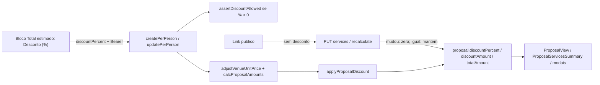

# Design — Desconto em % no orcamento

## Visao geral da solucao

O desconto mora na proposta: `discountPercent` (o que o dono escolheu) e `discountAmount` (R$ aplicado). Uma funcao pura (`applyProposalDiscount`) faz a conta sobre o subtotal do pipeline atual. A criacao e a edicao por pessoa recebem a %, conferem permissao e gravam os tres valores. Os fluxos publicos nunca leem a %: mantem o desconto quando nada muda e zeram quando o cliente muda algo. A tela aplica a mesma formula ao estimado do `/quote` e exibe subtotal, desconto e total no painel e no link.



## Componentes e modulos impactados

- `backend`:
  - `prisma/schema.prisma` e `prisma/migrations/20261110220000_add_proposal_discount/migration.sql`;
  - `src/functions/proposal-discount.ts` (novo) e spec;
  - `src/use-cases/proposal/proposal-quote-authorizer.ts` (`DISCOUNT_DENIAL`, `assertDiscountAllowed`);
  - `src/zod/proposal/create-proposal-per-person-params-schema.ts` e `update-proposal-per-person-params-schema.ts`;
  - use cases `create-proposal-per-person`, `update-proposal-per-person` e `update-proposal-per-day`;
  - `update-public-proposal-services` e `recalculate-public-proposal`;
  - `CreateProposalInDbParams` e `update-proposal-in-db-params-schema.ts` (campos novos).
- `frontend`:
  - `src/lib/proposal-discount.ts` (novo) e teste;
  - `src/components/proposal/ProposalQuoteSummary.tsx`;
  - `src/components/proposal/forms/PerPersonProposalForm.tsx` e `src/pages/ProposalEdit.tsx`;
  - `src/pages/ProposalView.tsx` (`applyPublicServices`, "Seu investimento");
  - `src/components/proposal/ProposalServicesSummary.tsx`;
  - `src/components/proposal/UpdateProposalServicesDialog.tsx` e `RecalculateProposalDialog`;
  - `src/types/proposal.ts` e `src/services/proposal.service.ts`.

## Reuso previsto

- `adjustVenueUnitPrice` e `calcProposalAmounts` (subtotal), sem mudar a formula
- `ProposalQuoteAuthorizer.assert` com `PermissionDenial` proprio, no formato de `assertCourtesyAllowed`
- `readOptionalUserId` na criacao e `req.user.id` na edicao, ja passados aos use cases pela cortesia
- `NO_QUOTE_MESSAGE` de `use-case-quote-proposal.ts`
- `useProposalQuote` e o bloco `ProposalQuoteSummary`

## Contratos e dados

Banco:

```sql
ALTER TABLE `proposal` ADD COLUMN `discountPercent` DOUBLE NOT NULL DEFAULT 0;
ALTER TABLE `proposal` ADD COLUMN `discountAmount` DOUBLE NOT NULL DEFAULT 0;
```

Corpo novo e opcional em `createPerPerson` e `updatePerPerson` (`data`):

```ts
discountPercent?: number // 0..100, ate 2 casas
```

Funcao (`functions/proposal-discount.ts`):

- `DISCOUNT_MESSAGE = "Informe um desconto de 0 a 100%, com até duas casas decimais."`
- `discountPercentValue(raw: unknown): number`: `undefined`/`null` vira 0; numero finito de 0 a 100 com `Math.round(p * 100) === p * 100` passa; o resto lanca `HttpBadRequestError(DISCOUNT_MESSAGE)`. Valida por conta propria porque o controller de `createPerPerson` nao aplica o Zod.
- `applyProposalDiscount(subtotal, percent)`: devolve `{ discountPercent, discountAmount, totalAmount }` com `discountAmount = round2(subtotal * percent / 100)` e `totalAmount = subtotal - discountAmount`. Com `percent` 0 devolve `discountAmount` 0 e `totalAmount = subtotal`.
- `NO_DISCOUNT = { discountPercent: 0, discountAmount: 0 }`.

Autorizacao (`proposal-quote-authorizer.ts`):

- `DISCOUNT_DENIAL = { log: "[proposal-discount] permissao negada", message: "Você não tem permissão para dar desconto neste espaço." }`;
- `assertDiscountAllowed(authorizer, authUserId, venueId, percent)`: sai se `percent` for 0; sem authorizer falha fechado com 403; senao `authorizer.assert(authUserId, venueId, DISCOUNT_DENIAL)`.

Criacao por pessoa (`use-case-create-proposal-per-person.ts`):

1. `percent = discountPercentValue(params.discountPercent)`; logo depois da cortesia, `assertDiscountAllowed` se `type !== "BARTER"`.
2. `BARTER`: grava `NO_DISCOUNT`, como hoje.
3. `percent > 0`: exige `hasCatalogPrice` (senao 400 `NO_QUOTE_MESSAGE`); segue o ramo automatico; grava `...applyProposalDiscount(amounts.totalAmount, percent)` no lugar de `totalAmount`.
4. `percent` 0: ramos atuais, gravando `NO_DISCOUNT`.

Edicao por pessoa (`use-case-update-proposal-per-person.ts`):

- mesma ordem; autoriza pelo `proposal.venueId` gravado e `authUserId` do token;
- `percent > 0` forca o ramo automatico (ignora a comparacao `totalAmountInput === proposal.totalAmount`);
- todos os ramos gravam os dois campos explicitamente (desconto ou `NO_DISCOUNT`).

Edicao por dia: todos os ramos gravam `NO_DISCOUNT`. Schema por dia nao ganha o campo.

Link publico:

- `PUT /presentation/:id/services`:
  - Zod publico nao ganha o campo;
  - sem mudanca (`currentResponse`): nada muda;
  - com mudanca: `subtotal = proposal.totalAmount + (proposal.discountAmount ?? 0)`; `totalAmount = subtotal - oldSum + newSum`; grava `NO_DISCOUNT`;
  - historico: `HISTORY_ACTION` + ` (desconto de X% removido)` quando havia desconto;
  - resposta (`data`) ganha `discountPercent` e `discountAmount` nos dois caminhos.
- `PUT /presentation/:id/recalculate`:
  - `unchanged = mesma data wall-clock && mesmo guestNumber && mesmas horas` do gravado;
  - `unchanged && discountPercent > 0`: grava `...applyProposalDiscount(amounts.totalAmount, discountPercent)`;
  - senao grava `amounts.totalAmount` e `NO_DISCOUNT`, com o sufixo no historico se havia desconto;
  - resposta ganha `discountPercent` e `discountAmount`.

Frontend:

- `lib/proposal-discount.ts`:
  - `parseDiscountInput(raw)`: aceita virgula; devolve `{ percent, error }`; vazio vale 0; erro com o mesmo texto do backend;
  - `applyDiscount(subtotal, percent)`: mesma formula e arredondamento do backend;
  - `discountLabel(percent)`: `Desconto (10%)`, com virgula decimal (`7,5%`).
- `ProposalQuoteSummary` vira controlado:
  - props `discountInput`, `discountError`, `onDiscountChange`; sai `onUseValue`;
  - mostra `Desconto (X%) - R$` e `Total com desconto` quando `percent > 0`;
  - campo `Desconto (%)` com `label` visivel e `inputMode="decimal"`; escondido na permuta.
- Formularios (`PerPersonProposalForm`, `ProposalEdit`):
  - estado `discountInput` e `discountTouched`;
  - efeito: com `discountTouched` e `quote`, `setValue(totalAmountInput, applyDiscount(quote.totalAmount, percent).totalAmount)`;
  - no `NumericFormat` do `Total`, `onValueChange` com `sourceInfo.source === "event"` limpa `discountInput` e `discountTouched`;
  - payload: `discountPercent: percent` (0 quando vazio);
  - `ProposalEdit` inicia `discountInput` com `currentProposal.discountPercent` quando maior que 0, com `discountTouched` verdadeiro; `saveNotice` compara com `applyDiscount(quote.totalAmount, percent).totalAmount`.
- Exibicao:
  - `ProposalView` "Seu investimento" e `ProposalServicesSummary`: com `discountPercent > 0`, linhas `Subtotal` (`totalAmount + discountAmount`) e `Desconto (X%)` (`- discountAmount`) antes do total;
  - `applyPublicServices` copia `discountPercent` e `discountAmount` da resposta; o recalculo ja faz merge de `data`;
  - `UpdateProposalServicesDialog` e `RecalculateProposalDialog` recebem `discountPercent` e mostram "O desconto de X% deixa de valer se você alterar o orçamento." quando maior que 0.

## Falhas, casos de borda e invariantes

- Invariante: `0 <= discountPercent <= 100`, `discountAmount >= 0`, `totalAmount + discountAmount` e o subtotal.
- `discountPercent` 0 implica `discountAmount` 0.
- O desconto nunca vem de rota publica; a unica fonte e um corpo autenticado e autorizado.
- O campo de % so aparece quando o bloco tem estimado; sem estimado (erro, `Calculando...`, sem dados) a tela nao aplica nada ao `Total`.
- Abrir o formulario sem tocar na % nao mexe no `Total`.
- Falha HTTP nao limpa o campo.

## Decisoes arquiteturais importantes

- Gravar `discountPercent` e `discountAmount`. Descartados:
  - so a %, porque reconstruir o subtotal no PUT publico exigiria dividir por `(1 - %)`, que quebra em 100% e acumula erro de `Float`;
  - gravar o subtotal no lugar do total, porque relatorios e pagamentos somam `totalAmount` liquido.
- A % entra so nos fluxos do dono por pessoa. Descartado: tambem por dia, porque o `/quote` nao cota por dia e a tela nao tem estimado para descontar.
- `/quote` sem desconto; a tela usa a mesma formula. Descartado: mandar a % ao `/quote`, porque cada tecla viraria uma cotacao nova sem ganho de precisao.
- Com % acima de 0 o backend calcula pelo pipeline e ignora `totalAmountInput`. Descartado: confiar no `Total` vindo da tela, porque o desconto gravado nao bateria com o total se a tela atrasasse.
- Desconto sem permissao retorna 401 ou 403. Descartado: ignorar em silencio, porque o dono veria um total diferente do gravado.

## Passada transversal

- architecture: nao ha fronteira nova. Mudam o corpo de duas rotas e a resposta de duas rotas publicas; sem ADR.
- database: sim. Duas colunas aditivas com default, branch mais deploy request, aplicadas na `main` antes do backend. Sem indice nem retencao.
- design: sim. Campo com rotulo visivel, teclado decimal, erro no campo; linhas de subtotal e desconto seguem a hierarquia atual do bloco e do "Seu investimento"; aviso curto nos dois modais.
- observability: nao ha metrica. `console.error` na negacao e sufixo no historico quando o link zera o desconto.
- security: sim. Criacao publica com campo que reduz valor, protegida por token mais permissao no espaco; rotas publicas sem o campo; testes negativos obrigatorios.
- patterns/rules/06: nao ha idempotencia, fila, cache nem retry novo. Ultima gravacao vence.

## Riscos e mitigacoes

- Backend no ar antes das colunas quebra toda leitura de `proposal`. Mitigacao: `T-01` aplicado e conferido com `SHOW COLUMNS` antes do deploy da API.
- Cliente se dar desconto pela criacao publica. Mitigacao: `assertDiscountAllowed` e os testes com token ausente, sem permissao e `userId` forjado.
- Centavos diferentes entre tela e gravado. Mitigacao: a mesma formula com teste de mesma entrada nos dois repos (5800 com 10% da 580 e 5220; 999,99 com 7,5% da 75,00 e 924,99).
- Desconto sobreviver a mudanca do cliente. Mitigacao: testes do PUT publico e do recalculo com e sem mudanca.

## Rollout, observabilidade e rollback

Ordem de entrega:

1. Deploy request das colunas na `main`.
2. API.
3. Frontend.

Rollback:

- frontend: reverter o build;
- API: reverter o build. As colunas ficam e sao ignoradas pelo codigo antigo; o `totalAmount` gravado ja e liquido;
- colunas: revert do deploy request so dentro da janela e so depois do rollback da API.

Nao ha flag.

## Estrategia de validacao

- unitario backend:
  - `proposal-discount` (formula, validacao, 0 e 100);
  - criacao e edicao por pessoa, com ramos de permissao, manual e permuta;
  - edicao por dia zerando;
  - PUT publico e recalculo com e sem mudanca.
- vitest frontend: `proposal-discount` e `ProposalQuoteSummary`.
- browser: criar com 10% e reabrir a edicao; digitar no `Total` e ver a % zerar; link com subtotal, desconto, aviso e desconto zerado apos alterar.
- comandos:
  - `npx prisma validate`;
  - `npm test -- --run` no backend;
  - `npm run build`, `npm run lint` e `npm test` no frontend.

## Fontes determinantes

- `project-decisions.md` D-05, D-07 e D-09
- `project/planetscale.md#Fluxo real de schema` e `#Permissoes do agente`
- `topics/pricing-and-proposal-calculation.md#Pipeline atual (proposal-amounts.ts)`
- `specs/2026-11-10-cortesia-servicos-orcamento/03-design.md#Contratos e dados`
- `art56_server_v3/src/use-cases/proposal/proposal-quote-authorizer.ts`
