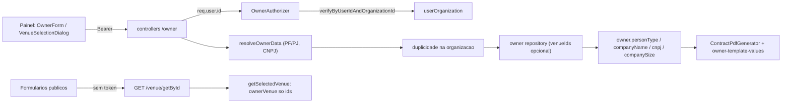

# Design — Proprietario pessoa fisica ou juridica

## Visao geral da solucao

O tipo de pessoa e o porte sao colunas em `Owner`. Uma funcao pura no backend (`resolveOwnerData`) e a unica regra de PF/PJ: recebe o registro atual (ou nada, na criacao) e o corpo, combina, normaliza o CNPJ e valida. Um `OwnerAuthorizer` resolve a organizacao pelo token e pelo registro gravado antes de qualquer leitura ou escrita em `/owner`. O repositorio so mexe nos vinculos quando `venueIds` vem no corpo. A rota publica de espaco deixa de incluir o proprietario. No painel, helpers puros em `lib/owner-document.ts` formatam documento, nome exibido e busca, e `lib/owner-template-values.ts` resolve as variaveis do PDF.



## Componentes e modulos impactados

- `backend`:
  - `prisma/schema.prisma` e `prisma/migrations/20261111190000_add_owner_person_type/migration.sql`;
  - `src/functions/owner-document.ts` (novo): `normalizeCnpj`, `isCnpjFormat`, `resolveOwnerData`, mensagens;
  - `src/zod/owner/create-owner-params-schema.ts`, `create-venue-owner-params-schema.ts`, `update-owner-params-schema.ts`;
  - `src/use-cases/owner/owner-authorizer.ts` (novo);
  - controllers, use cases e factories de `create-organization-owner`, `create-venue-owner`, `update-owner`, `delete-owner`, `list-owners`, `list-by-venue-owners`;
  - `src/repositories/in-prisma/owner-in-prisma-repository.ts` e `src/repositories/interface/owner-repository-interface.ts`;
  - `getSelectedVenue` em `src/repositories/in-prisma/venue-in-prisma-repository.ts`.
- `frontend`:
  - `src/types/owner.ts`;
  - `src/lib/owner-document.ts` (novo) e `src/lib/owner-template-values.ts` (novo), com testes;
  - `src/components/owner/OwnerForm.tsx`, `OwnersList.tsx` e `src/pages/OrganizationOwners.tsx`;
  - `src/components/venue/CreateVenueForm.tsx`, `src/pages/VenueSettings.tsx`, `src/components/proposal/forms/pf-contract-form.tsx` e `pj-contract-form.tsx`;
  - `src/types/contract.ts` e `src/components/proposal/forms/ContractPdfGenerator.tsx`.

## Reuso previsto

- `verifyByUserIdAndOrganizationId` para participacao na organizacao
- `venueRepository.getById` para ler `organizationId` do espaco
- formato do `ServiceAuthorizer` e do `service.spec.ts` (autorizador com repositorios por `Pick` e repositorio falso)
- `HttpTokenError`, `HttpForbiddenError`, `HttpResourceNotFoundError`, `HttpConflictError`, `HttpBadRequestError` e `handleErrors`
- `react-input-mask` ja usado no `OwnerForm`; rotulos do `PJContractPersonalInfoForm`

## Contratos e dados

Banco:

```sql
ALTER TABLE `owner`
  ADD COLUMN `personType` ENUM('PF', 'PJ') NOT NULL DEFAULT 'PF',
  ADD COLUMN `companyName` VARCHAR(191) NULL,
  ADD COLUMN `cnpj` VARCHAR(191) NULL,
  ADD COLUMN `companySize` ENUM('MEI', 'ME', 'EPP', 'DEMAIS') NULL;
```

Prisma:

```prisma
enum OwnerPersonType { PF PJ }
enum CompanySize { MEI ME EPP DEMAIS }

model Owner {
  personType  OwnerPersonType @default(PF)
  companyName String?
  cnpj        String?
  companySize CompanySize?
}
```

Corpo novo (todos opcionais, nos tres schemas de escrita):

```ts
personType?: "PF" | "PJ"
companyName?: string
cnpj?: string
companySize?: "MEI" | "ME" | "EPP" | "DEMAIS" | null // null so faz sentido na edicao
```

- Criacao: os schemas atuais mantem `completeName`, `cpf` e demais obrigatorios.
- Edicao: `data` perde `organizationId` (o `z.object` descarta chave desconhecida).

`src/functions/owner-document.ts`:

- `CNPJ_FORMAT = /^[A-Z0-9]{12}\d{2}$/`.
- `normalizeCnpj(raw)`: remove `.`, `/`, `-` e espacos; aplica `toUpperCase`.
- `isCnpjFormat(raw)`: `CNPJ_FORMAT.test(normalizeCnpj(raw))`.
- Mensagens:
  - `OWNER_COMPANY_REQUIRED = "Informe a razão social e o CNPJ da empresa."`;
  - `OWNER_CNPJ_FORMAT = "Informe um CNPJ com 12 letras ou números e 2 dígitos no final."`.
- `resolveOwnerData(current: Owner | null, patch)`:
  - devolve os campos a gravar;
  - `personType = patch.personType ?? current?.personType ?? "PF"`;
  - campos de empresa vem de `patch`, depois de `current`;
  - `companySize: null` no `patch` vence o gravado;
  - em PF, devolve `companyName`, `cnpj` e `companySize` como `null`;
  - em PJ, exige `companyName` nao vazio e `cnpj` valido, e devolve `cnpj` normalizado; senao lanca `HttpBadRequestError`;
  - nao toca nos outros campos (o repositorio grava o restante do `patch` como hoje).

`OwnerAuthorizer` (`src/use-cases/owner/owner-authorizer.ts`):

- `assertMember(userId, organizationId)`:
  - sem `userId`: `HttpTokenError`;
  - sem `userOrganization`: `console.error("[owner] acesso negado", { userId, organizationId })` e `HttpForbiddenError("Você não tem acesso a esta organização.")`.
- `assertVenuesInOrganization(venueIds, organizationId)`: espaco inexistente ou de outra organizacao lanca `HttpForbiddenError("Espaço fora desta organização.")`.
- `loadOwner(userId, ownerId)`:
  - le o proprietario;
  - se nao existe, ou se o usuario nao pertence a organizacao dele: `HttpResourceNotFoundError("Proprietario")`;
  - devolve o registro, que serve de `current` para a edicao.

Controllers:

- passam `(req as AuthenticatedRequest).user.id` ao use case;
- as factories injetam `OwnerAuthorizer` com os repositorios Prisma.

Use cases:

- criar na organizacao:
  - `assertMember`;
  - `assertVenuesInOrganization(venueIds)`;
  - `resolveOwnerData(null, body)`;
  - duplicidade;
  - criar.
- criar no espaco: igual, com `[venueId]`.
- editar:
  - `loadOwner`;
  - `assertVenuesInOrganization(venueIds)` se vier;
  - `resolveOwnerData(current, data)`;
  - duplicidade de PJ excluindo o proprio id;
  - atualizar.
- excluir: `loadOwner`, depois excluir.
- listar: `assertMember(organizationId)`.
- listar por espaco: `assertMember(organizationId)` e `assertVenuesInOrganization([venueId])`.

Duplicidade:

- repositorio ganha `findDuplicate({ organizationId, cnpj?, completeName?, excludeOwnerId? })`, que substitui `vefiryIfOwnerExists`;
- PJ busca por `organizationId` mais `cnpj` normalizado;
- PF (so na criacao) busca por `organizationId` mais `completeName`;
- conflito lanca `HttpConflictError("Proprietario com este CNPJ")` (PJ) ou `HttpConflictError("Proprietario")` (PF).

Repositorio `update`:

- `ownerVenue` so entra no `data` quando `venueIds !== undefined`;
- os campos resolvidos (`personType`, `companyName`, `cnpj`, `companySize`) sao gravados sempre, inclusive `null`.

`getSelectedVenue`: `ownerVenue: { select: { ownerId: true, venueId: true } }`. O tipo `Venue` do frontend ja descreve `ownerVenue` e nao le `owner` dali.

Frontend:

- `types/owner.ts`:
  - `OwnerPersonType = "PF" | "PJ"` e `CompanySize = "MEI" | "ME" | "EPP" | "DEMAIS"`;
  - `Owner` ganha `personType?`, `companyName?: string | null`, `cnpj?: string | null` e `companySize?: CompanySize | null`;
  - DTOs ganham os mesmos campos (`companySize` aceita `null` no update).
- `lib/owner-document.ts`:
  - `normalizeCnpj`, `isCnpjFormat` e `formatCnpj` (`XX.XXX.XXX/XXXX-XX`);
  - `personTypeOf(owner)`: `personType ?? "PF"`;
  - `ownerDisplayName(owner)`: PJ `"Razão (Representante)"`, PF `completeName`;
  - `ownerDocument(owner)`: CNPJ formatado ou CPF;
  - `ownerMatchesSearch(owner, term)`: compara termo e campos sem pontuacao e sem diferenciar maiusculas;
  - `representativeLabels(personType, companySize)`: Nome Completo/CPF/RG, Representante Legal/CPF do Representante/RG do Representante, ou Titular/CPF do Titular/RG do Titular;
  - `COMPANY_SIZE_OPTIONS` com os rotulos MEI, ME, EPP e Demais.
- `OwnerForm`:
  - `personType` (radio ou select), `companyName`, `cnpj` e `companySize` no Zod do form, com `superRefine` para PJ;
  - CNPJ com `InputMask` `mask="**.***.***/****-99"` e `formatChars={{ "*": "[A-Za-z0-9]", "9": "[0-9]" }}`, convertendo para maiusculas no `onChange`;
  - porte em `Select` com opcao "Não informar", que envia `null`.
- `lib/owner-template-values.ts`:
  - `OWNER_TEMPLATE_FIELDS`, com os campos de `DynamicField` do grupo owner;
  - `resolveOwnerTemplateValue(owner, prop)` devolve `string | undefined`:
    - campo conhecido sem valor devolve `""`;
    - `cnpj` devolve formatado;
    - `companySize` devolve o rotulo;
    - campo desconhecido devolve `undefined`.
  - `replaceTemplateVars` chama essa funcao quando `obj === "owner"`; `undefined` mantem o marcador.

## Falhas, casos de borda e invariantes

- Invariante: `personType = PF` implica `companyName`, `cnpj` e `companySize` `NULL`.
- Invariante: `personType = PJ` implica `companyName` nao vazio e `cnpj` no formato normalizado.
- Invariante: `owner.organizationId` nunca muda depois da criacao.
- Invariante: nenhuma rota sem token devolve campo de `Owner` alem de `ownerId`.
- A checagem de organizacao acontece antes de qualquer validacao de negocio, para o erro nao revelar dados de outra organizacao (ex.: 409 de CNPJ alheio).
- Corpo sem nenhum campo novo se comporta como hoje, so com o isolamento a mais.
- Falha HTTP no painel nao limpa o formulario.
- Os seletores de contrato mostram o nome exibido, mas o PDF continua recebendo o `Owner` inteiro.

## Decisoes arquiteturais importantes

- Colunas em `Owner`, reaproveitando `completeName`, `cpf` e `rg` como representante. Descartados:
  - tabela `OwnerCompany`, porque e 1:1 e complica a edicao;
  - `cpf` opcional, porque o representante sempre tem CPF.
- Regra PF/PJ numa funcao pura chamada pelos use cases. Descartados:
  - `z.discriminatedUnion`, porque a edicao parcial precisa do registro gravado para validar;
  - regra no repositorio, porque mistura persistencia com negocio.
- Autorizador por participacao na organizacao. Descartados:
  - `ensurePermission`, porque le permissao de espaco e exige `organizationId` no corpo ou na query, que editar e excluir nao tem;
  - confiar no `organizationId` do corpo, porque e forjavel.
- 404 para proprietario de outra organizacao. Descartado: 403, porque revela que o id existe.
- CNPJ normalizado no banco. Descartado: gravar com mascara, porque duplicidade e busca ficariam dependentes do formato digitado.
- `getSelectedVenue` sem o objeto `owner` para todos os chamadores. Descartados:
  - remover so quando nao ha `userId`, porque `userId` vem da query e e forjavel;
  - fechar a rota com token, porque quebra os formularios publicos.
- Vazio no PDF so para o grupo owner. Descartado: mudar a regra para todas as variaveis, porque mexe em contratos de cliente fora do escopo.

## Passada transversal

- architecture: nao ha fronteira nova. Muda o corpo das rotas de escrita de `/owner`, a autorizacao do router e o formato de `ownerVenue` em `GET /venue/getById`. Sem ADR.
- database: sim. Quatro colunas aditivas (duas `ENUM`) com default ou `NULL`, por branch e deploy request, aplicadas antes da API. Sem indice novo nem retencao.
- design: sim.
  - Seletor de tipo no topo, campos de empresa so em PJ, rotulos do representante dinamicos e erro no campo.
  - Lista com documento formatado.
  - Seletores com nome exibido. Sem token novo.
- observability: nao ha metrica. So o `console.error` sem PII na negativa de acesso.
- security: sim.
  - Isolamento por organizacao em seis rotas, com testes negativos.
  - Remocao de PII da rota publica.
  - Nenhum log com documento ou dado bancario.
- patterns/rules/06: duplicidade checada na aplicacao, sem lock nem indice unico (corrida aceita, ver `02-clarify.md`); sem fila, cache nem retry.

## Riscos e mitigacoes

- API nova no ar antes das colunas quebra toda leitura de `owner`. Mitigacao: `T-01` aplicado e conferido com `SHOW COLUMNS` antes do deploy da API.
- Usuario legitimo perder acesso por nao ter `userOrganization` (ex.: dono criado por fluxo antigo). Mitigacao: `T-03` confere na `main`, so leitura, que todo usuario com permissao de espaco tem `userOrganization`; se nao tiver, escalar.
- Formulario publico dependente do proprietario em `GET /venue/getById`. Mitigacao: busca por `ownerVenue` no frontend (feita: so `VenueSettings` le `ownerId`) e prova no browser do formulario publico em `T-02`.
- Painel antigo enviando `organizationId` na edicao. Mitigacao: o Zod descarta a chave sem erro.

## Rollout, observabilidade e rollback

Ordem de entrega:

1. `T-02` (API) pode ir ao ar sozinho, a qualquer momento.
2. Deploy request das colunas na `main` (`T-01`).
3. API com `T-03` a `T-05`.
4. Painel com `T-06` e `T-07`.

Rollback:

- painel: reverter o build;
- API: reverter o build. As colunas ficam e o codigo antigo as ignora. Os PJ criados nesse meio ficam com o CNPJ so no banco;
- colunas: revert do deploy request so dentro da janela e so depois do rollback da API.

Nao ha flag.

## Estrategia de validacao

- unitario backend:
  - `owner-document` (normalizacao, formato, `resolveOwnerData` em criacao e edicao);
  - schemas Zod;
  - `OwnerAuthorizer`;
  - use cases de criar, editar, excluir e listar com repositorio falso;
  - `GetVenueByIdUseCase` com repositorio falso.
- vitest frontend: `owner-document` e `owner-template-values`.
- browser:
  - criar PF e PJ MEI no painel;
  - editar so vinculos de uma PJ;
  - ver lista e seletores;
  - gerar PDF de PF legado e de PJ;
  - abrir um formulario publico do espaco e conferir a resposta sem `owner`.
- comandos:
  - `npx prisma validate` e `npm test -- --run` no backend;
  - `npm run build`, `npm run lint` e `npm test` no frontend.

## Fontes determinantes

- `project-decisions.md` D-05 e D-09
- `project/planetscale.md#Fluxo real de schema` e `#Permissoes do agente`
- `topics/auth-and-security.md#Regras de execucao`
- `art56_server_v3/src/use-cases/service/service-authorizer.ts` e `service.spec.ts`
- `art56_server_v3/src/repositories/in-prisma/owner-in-prisma-repository.ts`
- `eventhub-vista-dashboard/src/components/proposal/forms/ContractPdfGenerator.tsx#replaceTemplateVars`
