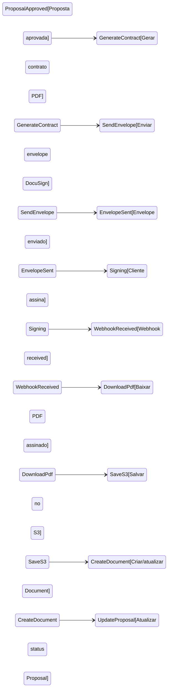

# Plano de integração DocuSign end-to-end (EventHub)

## 1. Mapa do fluxo desejado (estado a estado)



**Estados e campos novos:**

| Onde              | Campo/entidade                                                                                     | Uso                                                                                                                                                                       |
| ----------------- | -------------------------------------------------------------------------------------------------- | ------------------------------------------------------------------------------------------------------------------------------------------------------------------------- |
| **Proposal**      | `contractSignedAt` (DateTime?, opcional)                                                           | Preenchido quando webhook indica envelope completed; indica "contrato assinado".                                                                                          |
| **Proposal**      | (opcional) `contractSentViaDocusignAt` (DateTime?)                                                 | Quando o envelope foi enviado (rastreio).                                                                                                                                 |
| **Document**      | Já existe; usar `title` tipo "Contrato assinado (DocuSign)" e `imageUrl` = URL S3 do PDF assinado. |                                                                                                                                                                           |
| **Nova entidade** | **DocusignIntegration**                                                                            | Credenciais e config por Organization (integrationKey, secret, accountId, baseUrl, accessToken cifrado, refreshToken cifrado, enabled).                                   |
| **Nova entidade** | **DocusignEnvelope**                                                                               | proposalId, envelopeId (DocuSign), status (sent, delivered, signed, completed, declined, voided), documentId (após criar Document), organizationId, createdAt, updatedAt. |


Fluxo resumido: usuário com integração habilitada, na tela da proposta aprovada, clica "Enviar contrato via DocuSign" → backend gera PDF do contrato (ou recebe do FE em base64, como no email atual) → cria envelope no DocuSign com signer (email do cliente da proposta) → persiste DocusignEnvelope (status sent) → DocuSign envia webhook em eventos (delivered, completed, etc.) → handler verifica HMAC, atualiza DocusignEnvelope, e em "completed" baixa PDF → upload S3 → cria Document (proposalId, title, imageUrl) → atualiza Proposal (contractSignedAt) e DocusignEnvelope.documentId.

---

## 2. Levantamento do que falta no código atual

**Backend (art56_server_v3):**

- **Criar:** `src/integrations/docusign/` (client, auth, envelopes, webhooks, download, status-mapping, tipos).
- **Criar:** `src/router/docusign.ts` ou `src/router/integration-docusign.ts` + registro em [server.ts](../art56_server_v3/src/server.ts).
- **Criar:** use-cases: save-config, get-status, test-connection, send-envelope, webhook-handler, get-signed-document; controllers + factories + Zod.
- **Alterar:** [schema.prisma](../art56_server_v3/prisma/schema.prisma) — novas tabelas e campo(s) opcional em Proposal.
- **Alterar:** [server.ts](../art56_server_v3/src/server.ts) — rota de webhook sem `express.json()` na rota específica (para HMAC com body raw) ou leitura de raw body apenas no path do webhook.

**Frontend (eventhub-vista-dashboard):**

- **Criar:** Página "Integrações" (ex.: em Organization) — ex.: `src/pages/OrganizationIntegrations.tsx` ou dentro de OrganizationSettings.
- **Criar:** Componentes: form de credenciais DocuSign (integrationKey, userId/accountId, baseUrl, secret para webhook), botão "Testar conexão", status da integração.
- **Alterar:** [ProposalContract.tsx](../eventhub-vista-dashboard/src/pages/ProposalContract.tsx) / [ProposalContractForm.tsx](../eventhub-vista-dashboard/src/components/proposal/ProposalContractForm.tsx) — adicionar "Enviar via DocuSign", status do envelope (sent/signed/completed), reenviar, cancelar, link para download do assinado.
- **Criar:** Service e hooks (React Query) para: get/save integration config, test connection, send envelope, get envelope status, download signed.
- **Alterar:** Rotas em [App.tsx](../eventhub-vista-dashboard/src/App.tsx) — rota para Integrações (org-level); possivelmente store (Zustand) para estado de integração se fizer sentido.

**Riscos atuais que impactam DocuSign:**

| Risco                                                                                                       | Impacto                                                 | Mitigação no plano                                                                                                                                                                                                        |
| ----------------------------------------------------------------------------------------------------------- | ------------------------------------------------------- | ------------------------------------------------------------------------------------------------------------------------------------------------------------------------------------------------------------------------- |
| **req.userId não definido** ([ensureAuthenticate.ts](../art56_server_v3/src/middleware/ensureAuthenticate.ts))                                                         | Não dá para autorizar "só envelopes da org do usuário". | Implementar setar `req.userId` no ensureAuthenticate (já recomendado em SECURITY_HARDENING); em todo use case DocuSign validar que organizationId/venueId pertence ao usuário (via UserVenuePermission/UserOrganization). |
| **Rotas sensíveis sem auth** (document, proposal byId, etc.)                                                | Endpoints de integração e envelope devem ser privados.  | Todas as rotas `/integration/docusign/*` (exceto webhook) com `ensureAuthenticate`; webhook com verificação HMAC apenas.                                                                                                  |
| **CORS `origin: "*"`** ([server.ts](../art56_server_v3/src/server.ts))                                                                          | Aceita qualquer origem.                                 | Manter restrição por env (CORS_ORIGIN) conforme SECURITY_HARDENING; webhook é server-to-server, não depende de CORS do browser.                                                                                           |
| **Body limit 50mb / duplicata express.json()**                                                              | Webhook recebe JSON; body grande desnecessário.         | Rota de webhook pode usar `express.raw()` só para esse path (para HMAC com body exato) ou ler raw body em middleware específico; limite adequado só para esse route.                                                      |
| **Sem middleware global de erro**                                                                           | Falhas não convertidas em JSON.                         | Aplicar express-async-errors e middleware de erro global (já no roadmap); no webhook responder 200 rápido após enfileirar processamento para não timeout no DocuSign.                                                 |
| **Document/Proposal sem auth** ([document.ts](../art56_server_v3/src/router/document.ts), API_CONTRACTS)                                                 | List/create document sem token.                         | Novos endpoints DocuSign todos autenticados; acesso a Document existente continua como hoje (melhoria geral de auth em paralelo).                                                                                        |

---

## 3. Design da arquitetura da integração

**Pasta sugerida:** `art56_server_v3/src/integrations/docusign/`

| Módulo                | Responsabilidade                                                                                                                                                    |
| --------------------- | ------------------------------------------------------------------------------------------------------------------------------------------------------------------- |
| **client.ts**         | Cliente HTTP para API DocuSign (baseUrl por config); métodos: getEnvelope, listDocuments, downloadDocument, createEnvelope (envelopeDefinition).                    |
| **auth.ts**           | Obter access token (JWT ou refresh); trocar refreshToken por accessToken; armazenar/recuperar tokens cifrados.                                                   |
| **envelopes.ts**      | Criar envelope a partir de PDF (base64 ou buffer), signer email/name; mapear status DocuSign → enum interno.                                                        |
| **webhooks.ts**       | Receber POST, validar HMAC (X-Docusign-Signature-1, body raw, secret da config), parsear evento (envelopeId, status, eventId), idempotência por eventId/envelopeId. |
| **download.ts**       | Dado envelopeId e documentId (DocuSign), baixar PDF combinado; retornar buffer.                                                                                     |
| **status-mapping.ts** | DocuSign status string → EnvelopeStatus (sent, delivered, signed, completed, declined, voided).                                                                   |
| **types.ts**          | Interfaces: IDocuSignClient, DocusignConfig, EnvelopeStatus, EnvelopeSummary, WebhookPayload.                                                                       |

**Interfaces TypeScript (exemplos):**

```ts
// types.ts
interface DocusignConfig {
  organizationId: string;
  integrationKey: string;
  userId: string;           // accountId / user id DocuSign
  accountId: string;        // DocuSign account id
  baseUrl: string;          // https://demo.docusign.net ou production
  encryptedAccessToken?: string;
  encryptedRefreshToken?: string;
  webhookSecretKey?: string; // para HMAC
  enabled: boolean;
}

type EnvelopeStatus = 'sent' | 'delivered' | 'signed' | 'completed' | 'declined' | 'voided';

interface IDocuSignClient {
  createEnvelope(params: { documentBase64: string; documentName: string; signerEmail: string; signerName: string; emailSubject: string }): Promise<{ envelopeId: string }>;
  getEnvelope(envelopeId: string): Promise<{ status: string }>;
  downloadDocument(envelopeId: string): Promise<Buffer>;
}
```

**Armazenamento de credenciais:** Por Organization (tabela `DocusignIntegration`). Campos mínimos: organizationId, integrationKey, accountId, baseUrl, encryptedAccessToken, encryptedRefreshToken (ou só encryptedRefreshToken se usar JWT), webhookSecretKey cifrado, enabled. Criptografia em repouso: AES-256-GCM com chave derivada de variável de ambiente (ex.: DOCUSIGN_ENCRYPTION_KEY); nunca devolver accessToken/refreshToken/secrets ao cliente após salvar. Opção futura: Venue-level (venueId nullable na mesma tabela).

---

## 4. Modelo de dados / Prisma

**Novas tabelas (migrations aditivas):**

```prisma
model DocusignIntegration {
  id              String   @id @default(cuid())
  organizationId  String   @unique
  organization    Organization @relation(fields: [organizationId], references: [id], onDelete: Cascade)
  integrationKey  String
  accountId       String
  baseUrl         String   // demo ou production
  encryptedAccessToken  String?  @db.Text
  encryptedRefreshToken String? @db.Text
  webhookSecretKeyEnc  String?  @db.Text
  enabled         Boolean  @default(true)
  createdAt       DateTime @default(now())
  updatedAt       DateTime @updatedAt
  envelopes       DocusignEnvelope[]
  @@index([organizationId])
  @@map("docusign_integration")
}

model DocusignEnvelope {
  id             String   @id @default(cuid())
  proposalId     String
  proposal       Proposal @relation(fields: [proposalId], references: [id], onDelete: Cascade)
  organizationId String
  organization   Organization @relation(fields: [organizationId], references: [id], onDelete: Cascade)
  envelopeId     String   @unique  // DocuSign envelope id
  status         String   // sent | delivered | signed | completed | declined | voided
  documentId     String?  // Document (EventHub) após salvar PDF no S3
  document       Document? @relation(fields: [documentId], references: [id], onDelete: SetNull)
  lastEventId    String?  // idempotência webhook
  createdAt      DateTime @default(now())
  updatedAt      DateTime @updatedAt
  @@index([proposalId])
  @@index([organizationId])
  @@index([envelopeId])
  @@map("docusign_envelope")
}
```

**Alterações em modelos existentes:**

- **Organization:** adicionar `docusignIntegrations DocusignIntegration?` e `docusignEnvelopes DocusignEnvelope[]`.
- **Proposal:** adicionar `contractSignedAt DateTime?` (opcional) e `docusignEnvelopes DocusignEnvelope[]`.
- **Document:** adicionar `docusignEnvelopes DocusignEnvelope[]` (relação opcional 1:N pelo documentId).

**Estratégia de migration:** (1) Criar migration só com novas tabelas e novas colunas nullable/opcionais (contractSignedAt). (2) Não remover nenhuma coluna nem alterar tipos. (3) Seguir [MIGRATION_STRATEGY.md](../processo/MIGRATION_STRATEGY.md): backup, deploy em horário de baixo tráfego, rollback script.

---

## 5. Endpoints novos (API)

Base path sugerido: **`/integration/docusign`** (ou `/organization/:organizationId/integration/docusign`).

| Método | Path                                                         | Auth          | Descrição                                                                                                                                                                                                                                                           |
| ------ | ------------------------------------------------------------ | ------------- | ------------------------------------------------------------------------------------------------------------------------------------------------------------------------------------------------------------------------------------------------------------------- |
| PUT    | `/integration/docusign/config`                               | Bearer        | Salvar/atualizar config (integrationKey, accountId, baseUrl, tokens, webhookSecretKey). Body Zod: organizationId, integrationKey, accountId, baseUrl, accessToken?, refreshToken?, webhookSecretKey?. Resposta: { enabled, hasCredentials }. Nunca devolver tokens. |
| GET    | `/integration/docusign/config`                               | Bearer        | Query: organizationId. Retorno: { enabled, hasCredentials, baseUrl (não sensível) }.                                                                                                                                                                                |
| POST   | `/integration/docusign/test-connection`                      | Bearer        | Body: organizationId. Chama DocuSign (ex.: accounts ou userInfo); 200 { success } ou 4xx/5xx.                                                                                                                                                                       |
| POST   | `/integration/docusign/send-envelope`                        | Bearer        | Body Zod: proposalId, organizationId (ou inferir de proposal). Gera/usa PDF do contrato, cria envelope, persiste DocusignEnvelope. Retorno: { envelopeId, status: 'sent' }.                                                                                             |
| POST   | `/integration/docusign/webhook`                              | Nenhum (HMAC) | Recebe eventos DocuSign; valida HMAC; processa async (atualizar envelope, em completed: download → S3 → Document → Proposal.contractSignedAt). Resposta 200 rápida.                                                                                                 |
| GET    | `/integration/docusign/envelope/:envelopeId`                 | Bearer        | Status do envelope (e documentId se houver). Autorização: envelope da org do usuário.                                                                                                                                                                               |
| POST   | `/integration/docusign/envelope/:envelopeId/void`            | Bearer        | Cancelar envelope no DocuSign e atualizar status local.                                                                                                                                                                                                             |
| GET    | `/integration/docusign/proposal/:proposalId/envelope`        | Bearer        | Retorna envelope(s) da proposta (para UI: status, link download se completed).                                                                                                                                                                                      |
| GET    | `/integration/docusign/proposal/:proposalId/signed-document` | Bearer        | Redirecionar ou retornar URL do Document (S3) do contrato assinado, se existir.                                                                                                                                                                                     |

**Auth e permissões:** Todas exceto webhook: `ensureAuthenticate` + verificação de que o usuário tem acesso à Organization (e ao Venue da Proposal quando aplicável). Webhook: sem JWT; apenas validação HMAC com secret da config (por organizationId identificado via envelopeId → proposta → organizationId).

**Zod (exemplos):**

- saveConfig: organizationId, integrationKey, accountId, baseUrl, accessToken.optional(), refreshToken.optional(), webhookSecretKey.optional().
- sendEnvelope: proposalId (e opcionalmente organizationId).
- Webhook: body validado após HMAC (envelopeId, status, eventId, etc.).

---

## 6. Frontend

- **Telas/componentes:**
  - **Integrações (Organization):** Nova página ou aba em "Configurações" da organização: lista de integrações; card "DocuSign" com form (Integration Key, Account ID, Base URL, Access Token / OAuth conforme escolha, Webhook Secret), botão "Salvar" e "Testar conexão"; exibir status (conectado / erro).
  - **Proposal — Contrato:** Na tela já existente [ProposalContract.tsx](../eventhub-vista-dashboard/src/pages/ProposalContract.tsx) / [ProposalContractForm.tsx](../eventhub-vista-dashboard/src/components/proposal/ProposalContractForm.tsx): se a org tiver DocuSign habilitado, mostrar "Enviar contrato via DocuSign" (chama POST send-envelope); exibir status do envelope (aguardando assinatura / assinado / cancelado); botões "Reenviar" (novo envelope se permitido) e "Cancelar envelope"; link "Baixar contrato assinado" quando status completed (chama endpoint signed-document ou list documents).
- **State management:** React Query para: getConfig, testConnection, sendEnvelope, getEnvelopeByProposal, getSignedDocumentUrl; mutations para saveConfig, voidEnvelope. Store Zustand só se precisar de estado global de "integração habilitada" entre páginas (opcional).

---

## 7. Segurança (obrigatório e detalhado)

- **Secrets em repouso:** Criptografia AES-256-GCM para accessToken, refreshToken e webhookSecretKey antes de gravar em DocusignIntegration; chave em env (DOCUSIGN_ENCRYPTION_KEY). Nunca retornar esses campos em GET config; no PUT, aceitar em body e imediatamente cifrar e persistir.
- **Webhook DocuSign:** (1) Ler body raw (sem alterar espaços) para HMAC. (2) Header `X-Docusign-Signature-1` (Base64); algoritmo em `x-authorization-digest` (SHA256). (3) Computar HMAC-SHA256(body, webhookSecretKey), Base64, comparar com header. (4) Se falhar → 401. (5) Idempotência: guardar lastEventId (ou eventId) por envelope; ignorar evento já processado e retornar 200.
- **Rate limiting:** Aplicar rate limit nas rotas POST send-envelope e POST test-connection (ex.: 10 req/min por userId ou por organizationId).
- **Multi-tenant:** Em todo use case: obter organizationId do envelope/proposal e garantir que o usuário autenticado tem permissão nessa organização (via UserOrganizationPermission / UserVenuePermission conforme modelo atual). Webhook: identificar org pelo envelopeId → DocusignEnvelope → organizationId e usar apenas o secret dessa org.

---

## 8. Observabilidade

- **Logs estruturados:** (1) createEnvelope: organizationId, proposalId, envelopeId, durationMs. (2) webhook received: envelopeId, eventId, status, processOk. (3) download signed: envelopeId, documentId, durationMs. (4) failure: envelopeId, error message, stack só em não-produção. Alinhar ao [OBSERVABILITY_PLAN.md](./OBSERVABILITY_PLAN.md) (ex.: pino, JSON).
- **Métricas:** Contadores: docusign.envelope.sent, docusign.envelope.completed, docusign.webhook.received, docusign.webhook.validation_failed; latência de send-envelope e de download.
- **Alertas:** Falha recorrente de HMAC; taxa de 5xx no webhook; falha ao baixar documento após completed.

---

## 9. Plano de implementação por etapas (compatível com produção)

**Sprint 1 — Base infra + armazenamento + test connection + enviar envelope simples**

- Migration: tabelas DocusignIntegration e DocusignEnvelope; campo Proposal.contractSignedAt (nullable).
- Módulos em `integrations/docusign/`: client, auth (obter token), envelopes (createEnvelope), types; criptografia para secrets.
- Endpoints: PUT/GET config (sem retornar secrets), POST test-connection, POST send-envelope (PDF do contrato: receber base64 do FE como no email atual, ou gerar no BE se já houver serviço de PDF).
- Router com ensureAuthenticate; validar organização do usuário.
- Frontend: tela Integrações (form + test connection); na Proposal Contract, botão "Enviar via DocuSign" e chamada send-envelope.
- Smoke: salvar config (com token de sandbox), test connection 200, enviar envelope e ver no DocuSign sandbox.

**Sprint 2 — Webhooks + download + S3 + Document + estados**

- Webhook handler: rota POST `/integration/docusign/webhook` com body raw, HMAC, idempotência por eventId/envelopeId.
- Ao evento "completed": download PDF do DocuSign, upload S3 (reutilizar lógica de [controller-create-document](../art56_server_v3/src/use-cases/document/create-document/controller-create-document.ts)), criar Document (proposalId, title, imageUrl), atualizar DocusignEnvelope.documentId e status, atualizar Proposal.contractSignedAt.
- Endpoints: GET proposal/:proposalId/envelope, GET signed-document (ou URL).
- Frontend: mostrar status do envelope na proposta; link "Baixar contrato assinado" quando completed.
- Smoke: enviar envelope → assinar no sandbox → webhook recebido → Document criado e Proposal.contractSignedAt preenchido.

**Sprint 3 — Embedded signing + templates + UX**

- (Opcional) Embedded signing: geração de link de assinatura no app (returnUrl para voltar ao EventHub).
- (Opcional) Templates DocuSign: escolher template por organização/venue e enviar com dados da proposta.
- Refinamentos de UX: mensagens de erro claras, loading states, reenviar/cancelar envelope.

**Checklist smoke pós-deploy (DocuSign):**

- [ ] PUT config (sandbox) → GET config retorna hasCredentials true, sem tokens.
- [ ] POST test-connection → 200.
- [ ] POST send-envelope com proposalId válido → 200 e envelopeId; envelope visível no DocuSign.
- [ ] Webhook: enviar evento de teste (ou assinar) → 200; envelope local com status atualizado; em completed, Document criado e contractSignedAt setado.
- [ ] GET proposal/:proposalId/envelope e GET signed-document retornam dados corretos para usuário da org.

---

## Documentação a atualizar (GUIA_DE_IMPLEMENTACAO e INDEX)

- **API_CONTRACTS.md:** adicionar seção Integration / DocuSign com todos os endpoints e payloads.
- **DOMAIN_MODEL.md:** glossário DocusignIntegration, DocusignEnvelope; estado contractSignedAt em Proposal.
- **SECURITY_HARDENING.md:** menção a HMAC webhook DocuSign e criptografia de secrets.
- **OBSERVABILITY_PLAN.md:** eventos de log e métricas da integração DocuSign.
- **INDEX.md:** se for criado doc novo (ex.: DOCUSIGN_INTEGRATION.md), registrar no Mapa por Área.

---

## Trade-offs e decisões

- **PDF do contrato:** Primeira versão receber base64 do frontend (como em [send-contratct-to-email](../art56_server_v3/src/use-cases/email/send-contratct-to-email-case/controller-send-contrato-to-email.ts)) para não bloquear em geração server-side; depois introduzir geração no BE (HTML → PDF) se desejado.
- **Webhook em serverless (Vercel):** Handler deve responder 200 rápido e processar (download, S3, DB) em background; se necessário, usar fila ou invocação assíncrona para não estourar timeout.
- **Integração por Organization:** Implementação inicial só org-level; venueId nullable na tabela permite evolução futura por Venue sem breaking.
