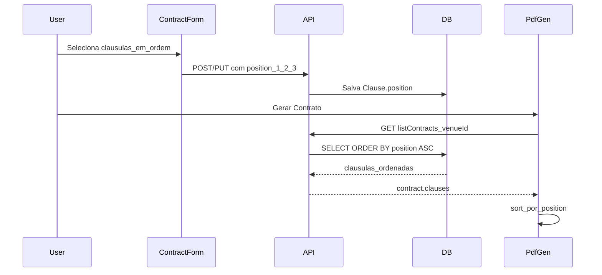

# Arquitetura atual — contratos e cláusulas

Mapa técnico do fluxo de definição, persistência e impressão de cláusulas.

---

## Fluxo end-to-end

---

## Modelagem de dados

### Entidades

| Entidade | Campos relevantes | Relação |
|----------|-------------------|---------|
| `Contract` | `id`, `name`, `title`, `organizationId` | N:N com `Clause` e com `Venue` |
| `Clause` | `id`, `text`, `title`, `position`, `organizationId` | N:N com `Contract` via `_ContractClauses` |

### Limitação do model N:N

A tabela implícita `_ContractClauses` contém apenas `A` (contractId) e `B` (clauseId) — **sem campo de ordem**.

O campo `position` vive na tabela `clause`, não na join table. Consequências:

- Na **criação** de contrato, o backend **copia** cláusulas (`clauses: { create: [...] }`), cada cópia com seu `position`
- A **biblioteca** de cláusulas (`organizationId`) é separada das cópias vinculadas ao contrato
- Reutilizar a **mesma** cláusula da biblioteca em dois contratos com ordens diferentes exigiria `position` por par contrato↔cláusula (Fase 3)

Referência: [database.dbml](../../referencias/database.dbml) — tabelas `contract`, `clause`, `_ContractClauses`.

---

## Arquivos por camada

| Camada | Arquivo | Papel |
|--------|---------|-------|
| Schema | `art56_server_v3/prisma/schema.prisma` | `Clause.position`, relação N:N |
| Backend | `art56_server_v3/src/repositories/in-prisma/contract-in-prisma-repository.ts` | CRUD + `include` clauses |
| Backend | `art56_server_v3/src/zod/contract/create-contract-params-schema.ts` | Validação `position` no create |
| Backend | `art56_server_v3/src/zod/contract/update-contract-params-schema.ts` | Validação `position` + `id` opcional no update |
| Backend | `art56_server_v3/src/repositories/in-prisma/clause-in-prisma-repository.ts` | CRUD da biblioteca de cláusulas |
| Frontend | `eventhub-vista-dashboard/src/components/contract/contracts/contract-form.tsx` | Seleção e ordem das cláusulas |
| Frontend | `eventhub-vista-dashboard/src/pages/OrganizationContracts.tsx` | Tela de gestão de contratos |
| Frontend | `eventhub-vista-dashboard/src/store/contractStore.ts` | Cache `contracts` e `venueContracts` |
| Frontend | `eventhub-vista-dashboard/src/components/proposal/forms/ContractPdfGenerator.tsx` | Geração do PDF |
| Frontend | `eventhub-vista-dashboard/src/components/proposal/forms/pf-contract-form.tsx` | Dispara PDF (PF) |
| Frontend | `eventhub-vista-dashboard/src/components/proposal/forms/pj-contract-form.tsx` | Dispara PDF (PJ) |

---

## Fluxo de criação de contrato

1. Usuário acessa **Organização → Contratos** (`OrganizationContracts.tsx`)
2. Seleciona cláusulas da biblioteca em ordem de clique (`contract-form.tsx` → `selectedClauseIds`)
3. Submit envia `{ name, title, venueIds, clauses: [{ text, title, position }] }`
4. Backend `create` cria registro `Contract` e **novas** linhas `Clause` com `position`
5. Resposta inclui `clauses` ordenadas (`orderBy: position asc`, `createdAt asc`) em todos os endpoints de leitura

---

## Fluxo de impressão (proposta)

1. Usuário abre proposta → formulário de contrato PF ou PJ
2. Seleciona contrato vinculado ao venue (`contractId`)
3. Clica **Gerar Contrato** → `generateContractPdf({ contract: venueContracts.find(...) })`
4. `venueContracts` foi carregado via `fetchVenueContracts` → `GET /contract/list?venueId=...`
5. API retorna contratos com `clauses` ordenadas por `position` ascendente
6. PDF ordena defensivamente por `position` e numera cláusulas (`toRoman(idx + 1)`)

---

## Endpoints envolvidos

Consultar detalhes em [API_CONTRACTS.md](../../referencias/API_CONTRACTS.md):

| Método | Rota | Uso neste fluxo |
|--------|------|-----------------|
| POST | `/contract/create` | Criar contrato com cláusulas |
| PUT | `/contract/update` | Atualizar contrato e cláusulas |
| GET | `/contract/list/...` | Listar contratos (incl. por venue — usado no PDF) |
| GET | `/contract/byId/:id` | Buscar contrato por ID |
| GET | `/clause/list` | Biblioteca de cláusulas da organização |

---

## Próximos passos

- ~~Correção imediata: [03-fase-1-correcao-imediata.md](./03-fase-1-correcao-imediata.md)~~ **Concluída (jul/2026)**
- Melhorias de UX: [04-fase-2-ux-edicao.md](./04-fase-2-ux-edicao.md)
