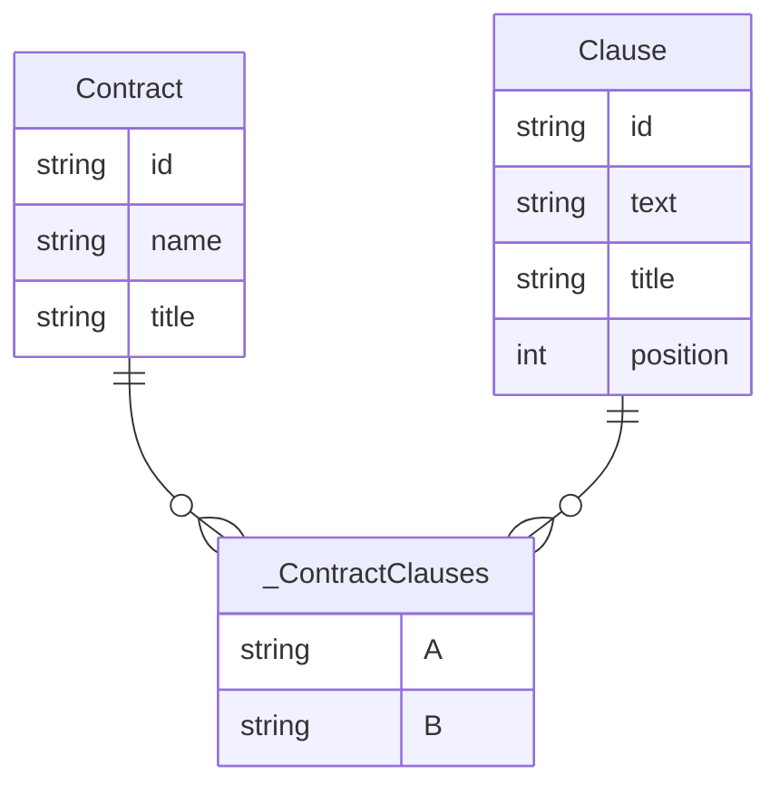

# Fase 3 — Modelo de dados (opcional)

**Objetivo:** `position` específica por par contrato↔cláusula, permitindo reutilizar a mesma cláusula da biblioteca com ordens diferentes em contratos distintos.

**Esforço estimado:** 1–2 dias + migration + backfill.

**Dependências:** Fases 1 e 2 concluídas; **decisão de produto** antes de iniciar.

---

## Quando esta fase é necessária

Implementar Fases 1–2 resolve o bug de impressão e melhora a UX para o fluxo atual (cópias de cláusulas por contrato).

A Fase 3 só é necessária se o negócio exigir:

- Uma **única** cláusula na biblioteca referenciada por **vários** contratos
- **Ordens diferentes** dessa mesma cláusula em cada contrato
- Eliminar duplicação de texto no banco

---

## Problema do model atual



- `position` está em `Clause`, não em `_ContractClauses`
- Relação N:N implícita no Prisma — join table sem metadados
- Workaround atual: **copiar** cláusula na criação do contrato (`clauses: { create: [...] }`)
- Consequência: texto duplicado; cláusulas órfãs após updates sem `id`

Referência: [database.dbml](../../referencias/database.dbml), [DATA_MODEL_EXPLAINED.md](../../referencias/DATA_MODEL_EXPLAINED.md).

---

## Opções de evolução

| Opção | Descrição | Prós | Contras |
|-------|-----------|------|---------|
| **A — Manter cópias + Fases 1–2** | Sem migration; continuar copiando cláusulas | Rápido; já funciona após Fase 1 | Duplicação de texto; órfãos |
| **B — `position` na join table** | Model explícito `ContractClause` com `contractId`, `clauseId`, `position` | Ordem por contrato; reutilização real | Migration + backfill; refactor repository |
| **C — Cláusulas sempre inline** | Remover biblioteca; cláusulas só existem dentro do contrato | Modelo simples | Perde reutilização entre contratos |

### Recomendação

**Opção A** para curto prazo (Fases 1–2).

**Opção B** se houver demanda confirmada de biblioteca compartilhada com ordens distintas.

---

## Opção B — detalhamento técnico

### Schema Prisma (conceitual)

Substituir relação implícita N:N por model explícito:

```prisma
model ContractClause {
  id         String   @id @default(cuid())
  contractId String
  clauseId   String
  position   Int
  contract   Contract @relation(fields: [contractId], references: [id], onDelete: Cascade)
  clause     Clause   @relation(fields: [clauseId], references: [id], onDelete: Cascade)

  @@unique([contractId, clauseId])
  @@index([contractId, position])
  @@map("contract_clause")
}
```

- Remover `position` de `Clause` (ou deprecar — ver migration)
- `Clause` permanece como biblioteca (`organizationId`, `text`, `title`)
- Ordem vive em `ContractClause.position`

### Migration strategy

Seguir [MIGRATION_STRATEGY.md](../../processo/MIGRATION_STRATEGY.md):

1. **Migration aditiva:** criar tabela `contract_clause` sem remover `_ContractClauses` ainda
2. **Backfill:** para cada par em `_ContractClauses`, inserir em `contract_clause` com `position` da cópia `Clause` vinculada
3. **Dual-write** (opcional): periodo em que create/update escreve em ambos
4. **Cutover:** repository passa a ler/escrever só `ContractClause`
5. **Cleanup:** remover `_ContractClauses` implícita e campo `position` de `Clause` se não usado na biblioteca

### Backfill (SQL conceitual)

```sql
-- Pseudocódigo — adaptar aos nomes reais das tabelas Prisma
INSERT INTO contract_clause (id, contractId, clauseId, position)
SELECT
  cuid(),
  cc.A AS contractId,
  cc.B AS clauseId,
  COALESCE(cl.position, 0)
FROM _ContractClauses cc
JOIN clause cl ON cl.id = cc.B;
```

Validar em staging antes de produção.

### Impacto no código

| Camada | Alteração |
|--------|-----------|
| `contract-in-prisma-repository.ts` | create/update/list/getById via `ContractClause` |
| `contract-form.tsx` | Payload pode referenciar `clauseId` da biblioteca + `position` |
| `ContractPdfGenerator.tsx` | Ordenar por `ContractClause.position` (Fase 1 já defende com sort) |
| Zod schemas | Ajustar shape de `clauses` no create/update |
| [API_CONTRACTS.md](../../referencias/API_CONTRACTS.md) | Documentar novo contrato |

---

## Opção C — cláusulas inline

- Remover aba “Cláusulas” da biblioteca ou transformá-la em templates
- Cláusulas criadas apenas no contexto do contrato
- Simplifica modelo; perde fluxo atual de reutilização

Só considerar se produto decidir abandonar biblioteca compartilhada.

---

## Critérios de aceite (Opção B)

- [ ] Mesma cláusula da biblioteca em dois contratos com posições 1 e 3 respectivamente
- [ ] PDF de cada contrato respeita ordem local
- [ ] Migration/backfill executado em staging sem perda de ordem
- [ ] Documentação de domínio e API atualizada

---

## Fora de escopo

- Implementação automática — esta fase requer aprovação explícita
- DocuSign ou outros fluxos de assinatura ([PLANO_INTEGRACAO_DOCUSIGN.md](../PLANO_INTEGRACAO_DOCUSIGN.md))

---

## Documentação a atualizar

Ver [07-atualizacoes-docs-externos.md](./07-atualizacoes-docs-externos.md) — seção Fase 3.

---

## Decisão

| Pergunta | Responsável |
|----------|-------------|
| Precisamos de biblioteca compartilhada com ordens distintas? | Produto / negócio |
| Volume de cláusulas órfãs justifica cleanup? | Engenharia + ops |

Se ambas forem “não”, **encerrar iniciativa após Fase 2**.
