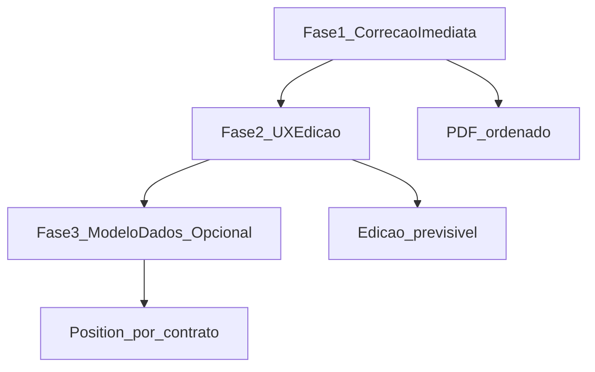

# Ordenação de cláusulas no contrato

**Problema:** o usuário define a ordem das cláusulas ao montar o contrato, mas o PDF impresso exibe as cláusulas em ordem aparentemente aleatória — apesar do campo `position` existir no banco.

Esta pasta reúne a documentação faseada para diagnosticar, corrigir e evoluir o fluxo de contratos. Use este README como ponto de entrada.

---

## Diagrama de fases

---

## Resumo das fases

| Fase | Objetivo | Esforço estimado | Arquivos principais | Dependências | Status |
|------|----------|------------------|---------------------|--------------|--------|
| **1 — Correção imediata** | API e PDF sempre respeitam `position` | 1–2 h | `contract-in-prisma-repository.ts`, `ContractPdfGenerator.tsx` | Nenhuma | **Concluída (jul/2026)** |
| **2 — UX e edição** | Ordem visível, reordenável e persistência sem duplicar cláusulas | 0,5–1 dia | `contract-form.tsx`, `update-contract-params-schema.ts` | Fase 1 | **Concluída (jul/2026)** |
| **3 — Modelo de dados** (opcional) | `position` por par contrato↔cláusula; reutilização real da biblioteca | 1–2 dias + migration | `schema.prisma`, migration Prisma | Fases 1–2; decisão de produto | Opcional |

---

## Documentos desta pasta

| Documento | Conteúdo |
|-----------|----------|
| [01-analise-problema.md](./01-analise-problema.md) | Diagnóstico, causa raiz e evidências no código |
| [02-arquitetura-atual.md](./02-arquitetura-atual.md) | Fluxo FE→BE→PDF, modelagem e arquivos envolvidos |
| [03-fase-1-correcao-imediata.md](./03-fase-1-correcao-imediata.md) | Fix crítico: `orderBy` no backend + sort no PDF |
| [04-fase-2-ux-edicao.md](./04-fase-2-ux-edicao.md) | Lista ordenada, reordenação e envio de `id` no update |
| [05-fase-3-modelo-dados.md](./05-fase-3-modelo-dados.md) | Evolução opcional do schema |
| [06-checklist-testes.md](./06-checklist-testes.md) | Casos de teste manuais e critérios de aceite |
| [07-atualizacoes-docs-externos.md](./07-atualizacoes-docs-externos.md) | O que atualizar fora desta pasta ao concluir cada fase |

---

## Referências externas

- [DOMAIN_MODEL.md](../../referencias/DOMAIN_MODEL.md) — glossário `Contract`, `Clause`
- [API_CONTRACTS.md](../../referencias/API_CONTRACTS.md) — endpoints de contrato e cláusula
- [database.dbml](../../referencias/database.dbml) — esquema `contract`, `clause`, `_ContractClauses`
- [GUIA_DE_IMPLEMENTACAO.md](../../processo/GUIA_DE_IMPLEMENTACAO.md) — protocolo antes/depois de codar
- [MIGRATION_STRATEGY.md](../../processo/MIGRATION_STRATEGY.md) — regras para Fase 3

---

## Ordem de execução recomendada

1. Ler [01-analise-problema.md](./01-analise-problema.md) e [02-arquitetura-atual.md](./02-arquitetura-atual.md)
2. ~~Implementar [03-fase-1-correcao-imediata.md](./03-fase-1-correcao-imediata.md)~~ **Concluído**
3. ~~Validar com [06-checklist-testes.md](./06-checklist-testes.md) (seção Fase 1)~~ **Concluído**
4. ~~Implementar [04-fase-2-ux-edicao.md](./04-fase-2-ux-edicao.md)~~ **Concluído**
5. ~~Validar com [06-checklist-testes.md](./06-checklist-testes.md) (seção Fase 2)~~ **Concluído (revisão de código; validar E2E local antes de deploy)**
6. **Próximo:** Avaliar necessidade de [05-fase-3-modelo-dados.md](./05-fase-3-modelo-dados.md) com stakeholders
7. Atualizar docs externos conforme [07-atualizacoes-docs-externos.md](./07-atualizacoes-docs-externos.md) — Fase 2 concluída
