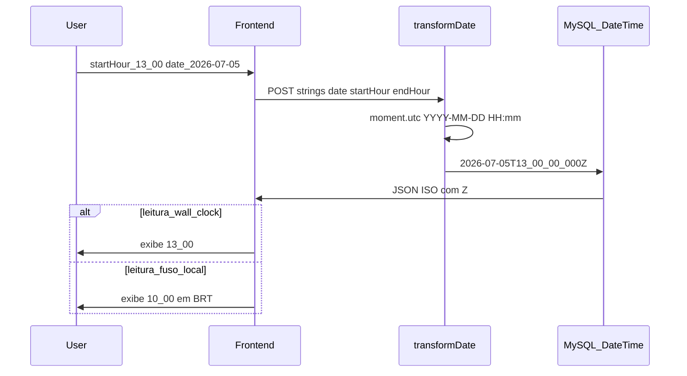
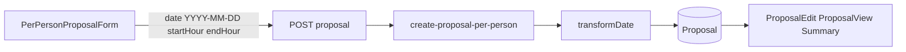

# Arquitetura atual — horários de evento

Mapa técnico do fluxo de seleção, persistência, leitura e exibição de horários de evento no EventHub.

---

## Fluxo end-to-end



---

## Ponto central de persistência

**Arquivo:** `art56_server_v3/src/functions/transform-date.ts`

**Entrada:** strings separadas

| Parâmetro | Exemplo | Origem típica |
|-----------|---------|---------------|
| `date` | `05/07/2026` ou `2026-07-05` | `<input type="date">` ou `toLocaleDateString` |
| `startHour` | `13:00` | `<select>` ou `<input type="time">` |
| `endHour` | `18:00` | idem |
| `divisor` | `/` (default) | separador da data |

**Saída:** `{ startDate: Date, endDate: Date }` — objetos JS cujo ISO UTC preserva os componentes digitados.

**Use-cases que chamam `transformDate`:**

| Domínio | Arquivos |
|---------|----------|
| Proposta per-person | `create-proposal-per-person`, `update-proposal-per-person` |
| Proposta per-day | `create-proposal-per-day`, `update-proposal-per-day` |
| DateEvent same-day | `create-data-event`, `update-same-day-date-event` |
| DateEvent overnight | `create-overnight-data-event`, `update-overnigth-date-event` |
| Schedule | `create-schedule`, `update-schedule` |
| Cálculo de preço | `calc-custom-total-amount`, `calc-standart-total-amount` |

---

## Modelagem de dados (Prisma)

Campos `DateTime` relevantes para wall-clock:

| Modelo | Campo(s) | Uso |
|--------|----------|-----|
| `Proposal` | `startDate`, `endDate` | Data/hora principal do orçamento |
| `DateEvent` | `startDate`, `endDate` | Eventos no calendário do venue |
| `Schedule` | `startHour`, `endHour` | **DateTime** (nome sugere hora, mas armazena datetime completo) |
| `Payment` | `paymentDate` | Data de pagamento (sem hora de evento — tratar como date-only na Fase 4) |
| `Expense` | `paymentDate` | Idem |

Campos **fora do escopo** wall-clock (timestamps reais):

- `createdAt`, `updatedAt` em qualquer modelo
- `Session.expiresAt`, `RefreshToken.expireIn`
- `GoogleCalendarIntegration.tokenExpiresAt`
- `User.passwordResetExpires`, `emailConfirmationExpires`

Referência: [DATA_MODEL_EXPLAINED.md](../../referencias/DATA_MODEL_EXPLAINED.md), `art56_server_v3/prisma/schema.prisma`.

---

## Fluxos por domínio

### Proposta per-person



- **Form:** `eventhub-vista-dashboard/src/components/proposal/forms/PerPersonProposalForm.tsx`
- **Leitura:** mistura estratégias A e B (ver inventário)

### Proposta per-day (pernoite)

- **Form:** `PerDayProposalForm.tsx` — `startDay`, `endDay`, `startHour`, `endHour`
- **Backend:** dois calls a `transformDate` (check-in no `startDay`, check-out no `endDay`)
- Venue pode sobrescrever horários com `checkIn` / `checkOut`

### DateEvent (calendário do venue)

- **Página:** `VenueSchedule.tsx` — criação/edição + `react-big-calendar`
- **Form alternativo:** `dateEvent-form.tsx` (dentro da proposta)
- **Sync:** `GoogleCalendarSyncService` após create/update/delete

### Schedule (cronograma / atrações)

- **Frontend envia:** `startHour: "14:00"` (string HH:mm)
- **Backend:** combina com **data da proposta** via `transformDate(proposal.startDate.toLocaleDateString('pt-BR'), ...)`
- **Persiste:** datetime completo em colunas `startHour`/`endHour`
- **Frontend lê:** extrai hora da ISO retornada

### E-mail e notificações

- **E-mail presença:** `send-attendence-confirmation-to-email` — formata com `date-fns` local
- **Notificações in-app:** use-cases de proposal e dateEvent usam `format(startDate, "dd/MM/yyyy")` sem UTC

### PDF de contrato

- **Arquivo:** `ContractPdfGenerator.tsx`
- Placeholders ISO: usa `getUTC*` — **correto**
- Deve migrar para util central na Fase 3 (consistência)

---

## Decisão arquitetural (Fases 1–4)

| Decisão | Escolha | Motivo |
|---------|---------|--------|
| Tipo no banco | Manter `DateTime` | Sem migration; retrocompatível |
| Semântica de armazenamento | Componentes UTC = wall-clock | Já implementado em `transformDate` |
| Util compartilhado | `wall-clock-datetime.ts` (FE + BE) | Uma regra, uma API |
| Migration futura (opcional) | Colunas `date` + `time` VARCHAR | Só se wall-clock em `DateTime` continuar confundindo; **fora do escopo atual** |

---

## Contrato API (serialização)

A API retorna datas como strings ISO 8601 com sufixo `Z`:

```json
{
  "startDate": "2026-07-05T13:00:00.000Z",
  "endDate": "2026-07-05T18:00:00.000Z"
}
```

**Interpretação correta no cliente:** hora literal `13:00` e `18:00`, **não** “instante absoluto convertido para BRT”.

Documentar explicitamente em [API_CONTRACTS.md](../../referencias/API_CONTRACTS.md) após Fase 3 (ver [10-atualizacoes-docs-externos.md](./10-atualizacoes-docs-externos.md)).

---

## Arquivos-chave por camada

### Backend

| Arquivo | Papel |
|---------|-------|
| `src/functions/transform-date.ts` | Montagem startDate/endDate |
| `src/functions/calc-event-duration.ts` | Duração entre datetimes wall-clock |
| `src/use-cases/schedule/create-schedule/use-case-create-schedule.ts` | Data da proposta + hora da atração |
| `src/services/google-calendar-sync-service.ts` | Sync externo |
| `src/use-cases/email/send-attendence-confirmation-to-email/...` | E-mail ao convidado |

### Frontend

| Arquivo | Papel |
|---------|-------|
| `src/lib/utils.ts` | `formatDate` genérico (problemático para eventos) |
| `src/pages/VenueSchedule.tsx` | Calendário + form principal |
| `src/pages/ProposalEdit.tsx` | Edição de horário da proposta |
| `src/pages/ProposalView.tsx` | Visualização pública |
| `src/components/dateEvent/dateEvent-form.tsx` | Form de datas na proposta |
| `src/pages/ScheduleList.tsx` | Cronograma de atrações |

---

## Referências

- [01-analise-problema.md](./01-analise-problema.md)
- [03-convencao-wall-clock.md](./03-convencao-wall-clock.md)
- [08-inventario-arquivos.md](./08-inventario-arquivos.md)
