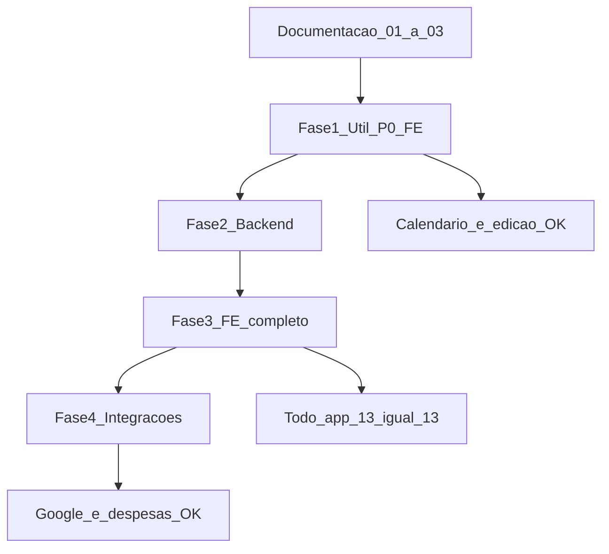

# Horário wall-clock (sem conversão de fuso)

**Problema:** o usuário seleciona um horário (ex.: `13:00`), mas em algumas telas o valor salvo ou exibido difere — frequentemente com deslocamento de 3 horas no Brasil (UTC−3).

Esta pasta reúne a documentação faseada para padronizar **horário de parede** em todo o EventHub: escolheu `13:00` → salva `13:00` → exibe `13:00`. Use este README como ponto de entrada.

---

## Regra de produto

> Horários de **evento** (proposta, dateEvent, cronograma, e-mail/PDF de evento) são **wall-clock**: não convertem para fuso local do browser ou do servidor.

Timestamps reais (`createdAt`, `updatedAt`, expiração de sessão) **não** entram nesta regra.

---

## Diagrama de fases

---

## Resumo das fases

| Fase | Objetivo | Esforço estimado | Arquivos principais | Dependências | Status |
|------|----------|------------------|---------------------|--------------|--------|
| **1 — Util + P0 frontend** | Util central; corrigir calendário do venue e telas críticas de proposta | 0,5–1 dia | `wall-clock-datetime.ts`, `VenueSchedule.tsx`, `ProposalView.tsx` | Nenhuma | **Concluído** (jul/2026) |
| **2 — Backend** | `transformDate` dual-format; e-mails/notificações; schedule sem `toLocaleDateString` | 0,5–1 dia | `transform-date.ts`, use-cases de e-mail/notification/schedule | Fase 1 (convencão) | Pendente |
| **3 — Frontend completo** | Varredura de todos os arquivos FE restantes | ~1 dia | `BudgetDetails`, `ScheduleList`, `dateEvent-*`, `lib/utils.ts` | Fases 1–2 | Pendente |
| **4 — Integrações** | Google Calendar sync; despesas (data só-dia) | ~0,5 dia | `google-calendar-sync-service.ts`, expense controllers | Fase 3 | Pendente |

---

## Documentos desta pasta

| Documento | Conteúdo |
|-----------|----------|
| [01-analise-problema.md](./01-analise-problema.md) | Diagnóstico, causa raiz e evidências no código |
| [02-arquitetura-atual.md](./02-arquitetura-atual.md) | Fluxo FE→BE→DB, campos Prisma e domínios afetados |
| [03-convencao-wall-clock.md](./03-convencao-wall-clock.md) | Contrato normativo: DO/DON'T e API dos utils |
| [04-fase-1-util-e-p0-frontend.md](./04-fase-1-util-e-p0-frontend.md) | Util central + correções P0 no frontend |
| [05-fase-2-backend.md](./05-fase-2-backend.md) | Backend: persistência, e-mails, notificações |
| [06-fase-3-frontend-completo.md](./06-fase-3-frontend-completo.md) | Varredura completa do frontend |
| [07-fase-4-integracoes.md](./07-fase-4-integracoes.md) | Google Calendar, despesas, fora de escopo |
| [08-inventario-arquivos.md](./08-inventario-arquivos.md) | Tabela mestre grep-driven por arquivo |
| [09-checklist-testes.md](./09-checklist-testes.md) | Casos de teste manuais e critérios de aceite |
| [10-atualizacoes-docs-externos.md](./10-atualizacoes-docs-externos.md) | O que atualizar fora desta pasta ao concluir cada fase |

---

## Referências externas

- [DATA_MODEL_EXPLAINED.md](../../referencias/DATA_MODEL_EXPLAINED.md) — campos `DateTime` e semântica de datas
- [REGRAS_DE_NEGOCIO.md](../../referencias/REGRAS_DE_NEGOCIO.md) — regras de comportamento (atualizar na Fase 3)
- [API_CONTRACTS.md](../../referencias/API_CONTRACTS.md) — contratos Proposal, DateEvent, Schedule
- [INTEGRATIONS_GOOGLE_CALENDAR.md](../../INTEGRATIONS_GOOGLE_CALENDAR.md) — sync de eventos
- [GUIA_DE_IMPLEMENTACAO.md](../../processo/GUIA_DE_IMPLEMENTACAO.md) — protocolo antes/depois de codar
- [KNOWN_LIMITATIONS.md](../../estado/integracao/KNOWN_LIMITATIONS.md) — dívidas conhecidas
- Código central: `art56_server_v3/src/functions/transform-date.ts`

---

## Ordem de execução recomendada

1. Ler [01-analise-problema.md](./01-analise-problema.md), [02-arquitetura-atual.md](./02-arquitetura-atual.md) e [03-convencao-wall-clock.md](./03-convencao-wall-clock.md)
2. Implementar [04-fase-1-util-e-p0-frontend.md](./04-fase-1-util-e-p0-frontend.md)
3. Validar com [09-checklist-testes.md](./09-checklist-testes.md) (seção Fase 1)
4. Implementar [05-fase-2-backend.md](./05-fase-2-backend.md)
5. Validar com [09-checklist-testes.md](./09-checklist-testes.md) (seção Fase 2)
6. Implementar [06-fase-3-frontend-completo.md](./06-fase-3-frontend-completo.md)
7. Validar com [09-checklist-testes.md](./09-checklist-testes.md) (seção Fase 3)
8. Implementar [07-fase-4-integracoes.md](./07-fase-4-integracoes.md) (se necessário)
9. Atualizar docs externos conforme [10-atualizacoes-docs-externos.md](./10-atualizacoes-docs-externos.md)
10. Re-auditar com os comandos em [08-inventario-arquivos.md](./08-inventario-arquivos.md)
