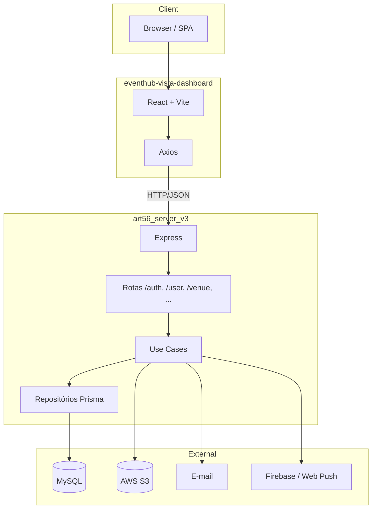

# Visão geral da arquitetura — EventHub

**Objetivo:** Visão geral do sistema (o que é, componentes, fluxos principais, organização de módulos) e pontos fortes/riscos atuais. Baseado apenas no código do repositório.

**Fontes no repositório:** `eventhub-vista-dashboard/`, `art56_server_v3/`, `art56_server_v3/src/server.ts`, `art56_server_v3/prisma/schema.prisma`, [FRONTEND_ANALISE_ATUAL.md](./FRONTEND_ANALISE_ATUAL.md), [BACKEND_ANALISE_ATUAL.md](./BACKEND_ANALISE_ATUAL.md), [INTEGRACAO_FRONT_BACK_ANALISE_ATUAL.md](./INTEGRACAO_FRONT_BACK_ANALISE_ATUAL.md).

---

## 1. O que é o sistema

EventHub é uma aplicação para gestão de **organizações**, **espaços (venues)** e **propostas/orçamentos** de eventos. Inclui:

- Dashboard para gestão de organizações, venues, propostas, pagamentos, documentos, contratos, notificações.
- Website público por organização/venue (dados via API sem auth).
- Formulários públicos (formulário de proposta por venue, listas de convidados/funcionários, contratos PJ/PF por proposta).
- Autenticação (email/senha e Google OAuth), permissões por organização e por venue (lista de permissões em string no banco).
- Integrações: AWS S3 (upload de imagens/documentos), e-mail (Nodemailer), notificações (Firebase Admin, Web Push).

---

## 2. Componentes

| Componente | Tecnologia / Onde | Observação |
|------------|-------------------|------------|
| **Frontend** | Vite 5, React 18, TypeScript, Tailwind, shadcn/Radix, Zustand, React Query, Axios | `eventhub-vista-dashboard/` |
| **Backend** | Node.js, Express, TypeScript, Prisma, MySQL | `art56_server_v3/` |
| **Banco de dados** | MySQL (Prisma com `relationMode = "prisma"` — sem FKs no banco) | `DATABASE_URL`, `SHADOW_DATABASE_URL` |
| **Armazenamento de arquivos** | AWS S3 | `AWS_BUCKET_NAME`, `AWS_REGION`, `AWS_ACCESS_KEY_ID`, `AWS_SECRET_ACCESS_KEY` |
| **E-mail** | Nodemailer | `EMAIL_PASSWORD`, `EMAIL_GMAIL_PASSWORD` (envs usadas no código) |
| **Notificações** | Firebase Admin, Web Push (VAPID) | `FIREBASE_*`, `VAPID_PUBLIC_KEY`, `VAPID_PRIVATE_KEY` |
| **Deploy BE** | Vercel (serverless) | `vercel.json` aponta `src/server.ts` |

---

## 3. Diagrama de alto nível

---

## 4. Fluxos principais

### 4.1 Autenticação

- **Registro/Login:** POST `/auth/register`, `/auth/register/google`, `/auth/authenticate`. Resposta com `accessToken` e `session` (id, userId, refreshTokenId, expiresAt).
- **Frontend:** Armazena em `localStorage`: `@EventHub:token` (accessToken), `@EventHub:session`. Interceptor Axios adiciona `Authorization: Bearer <token>`.
- **Refresh:** Em 401, o FE chama GET `/auth/refresh` (sem body). No BE o handler de refresh espera `req.body.accessToken` — **incompatibilidade confirmada no repositório**; POST `/token/refresh` com body existe mas o FE não usa.
- **Middleware BE:** `ensureAuthenticate` apenas valida JWT com `verify()`; **não seta `req.userId`** (código que setava está comentado em `ensureAuthenticate.ts`).

### 4.2 Organization → Venue → Proposal

- **Hierarquia:** Organization tem vários Venues; Venue tem Proposals (orçamentos/eventos).
- **Navegação típica:** Dashboard → escolher organização → `/organization/:id/venues` → escolher venue → `/venue/:id` (dashboard do espaço) → eventos, orçamentos (proposals), relatórios, website, etc.
- **Proposal:** Subrotas no FE para detalhes, edição, datas, pagamento, documentos, contrato, envio, listas. Criação de proposta (createPerPerson/createPerDay) e byId no BE **sem** `ensureAuthenticate` (acesso público por design para formulários).

### 4.3 Upload

- **Fluxo:** FE envia `multipart/form-data` (ex.: `file`, `venueId`, etc.). BE usa Multer (memória) e envia para S3; em imagens usa Sharp (ex.: WebP). Rotas de image, document, payment, emailConfig **sem** `ensureAuthenticate` no código atual.

### 4.4 Website público

- **Dados públicos:** GET `/venue/getWebData/:venueId?`, GET `/organization/getHubData`, GET `/organization/getOrganizationWebData/:organizationId?` — sem auth.
- **Formulários públicos:** `/venue/:id/form`, `/proposal/:id/view`, listas de convidados/funcionários, contratos B2B/PF — rotas FE que não exigem login; BE expõe create/byId de proposal e outras rotas sem auth.

---

## 5. Organização dos módulos

### 5.1 Backend (`art56_server_v3/src/`)

| Camada | Pasta | Conteúdo |
|--------|-------|----------|
| Entrada HTTP | `router/` | Um arquivo por recurso (auth, user, venue, organization, proposal, payment, image, document, etc.); aplicação de `ensureAuthenticate` por rota ou `router.use(ensureAuthenticate)` |
| Lógica de negócio | `use-cases/<recurso>/<ação>/` | `controller-*`, `use-case-*`, `factory-*`; validação Zod nos controllers |
| Dados | `repositories/in-prisma/`, `repositories/interface/` | Implementações Prisma e interfaces |
| Middleware | `middleware/` | `ensureAuthenticate.ts` (só verify JWT) |
| Validação | `zod/` | Schemas por recurso (create, update, list, getById, etc.) |
| Serviços/infra | `services/`, `provider/` | prisma-client, upload S3, Firebase, Web Push, refresh-token, send-forgot-password-email |
| Erros | `errors/` | error-handler, tipos (HttpTokenError, HttpConflictError, etc.) |

### 5.2 Frontend (`eventhub-vista-dashboard/src/`)

| Camada | Pasta | Conteúdo |
|--------|-------|----------|
| Rotas | `App.tsx` | Todas as rotas em um único arquivo; `ProtectedRoute` com `requiredPermission` por rota |
| UI | `components/` | Por domínio (venue, organization, proposal, contract, etc.) + `ui/` (shadcn) |
| Estado | `store/` (Zustand), `hooks/` (React Query) | Dupla fonte para alguns recursos (ex.: venue list em store e em useGetVenuesList) |
| HTTP | `lib/axios.ts`, `services/` | Uma instância Axios, serviços por domínio |
| Tipos | `types/` | DTOs e enums (incl. permissões VIEW_ORG_*, VIEW_VENUE_*, etc.) |

---

## 6. Pontos fortes e riscos atuais

### Pontos fortes

- Separação clara no BE: router → controller → use case → repository; Zod para validação de entrada.
- Repositórios abstraídos por interfaces em vários use cases.
- FE organizado por domínio (components, services, store, hooks); design system (shadcn) em `components/ui`.
- Permissões no FE mapeadas por rota (VIEW_ORG_*, VIEW_VENUE_*, VIEW_PROPOSAL_*, etc.) e checadas no `ProtectedRoute`.

### Riscos atuais

- **Auth:** Refresh GET sem body vs BE que espera body; `req.userId` não definido no BE; várias rotas sensíveis (image, document, payment, text, proposal create/byId, etc.) sem `ensureAuthenticate`.
- **Segurança:** CORS `origin: "*"`, body limit 50mb, 500 pode expor `error.toString()`, token em localStorage (XSS).
- **Estabilidade:** Rotas FE que não existem no BE (GET document by ID, GET payment by ID); sem middleware global de erro no Express; `express-async-errors` não importado.
- **Consistência:** Dupla fonte de verdade (Zustand + React Query) no FE; typo `organizattionId` no store/ProtectedRoute; hook `useGetVenuesList` com assinatura incompatível com o service.

---

## Decisões e recomendações

- Priorizar: (1) alinhar refresh token FE/BE (POST `/token/refresh` com body); (2) setar `req.userId` no `ensureAuthenticate`; (3) aplicar `ensureAuthenticate` de forma incremental nas rotas sensíveis; (4) CORS e body limit por variável de ambiente.
- Manter evolução incremental: não remover rotas nem quebrar contratos sem camada de compatibilidade (ver [MIGRATION_STRATEGY.md](./MIGRATION_STRATEGY.md) e [SECURITY_HARDENING.md](./SECURITY_HARDENING.md)).
