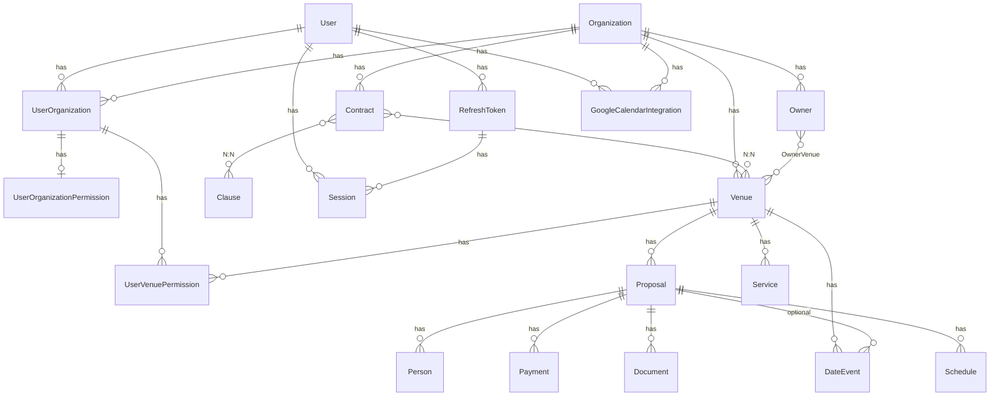

# Modelo de dados explicado — EventHub

**Objetivo:** Explicar o banco em termos de domínio (não só tabelas), principais entidades e relacionamentos, campos sensíveis/importantes, observações de integridade (relationMode, FKs, riscos) e índices/sugestões quando aplicável.

**Fontes no repositório:** `art56_server_v3/prisma/schema.prisma`, [database.dbml](./database.dbml), [BACKEND_ANALISE_ATUAL.md](./BACKEND_ANALISE_ATUAL.md), [DOMAIN_MODEL.md](./DOMAIN_MODEL.md).

---

## 1. Visão em termos de domínio

- **Usuário e sessão:** User (credenciais, avatar, googleId, fcmToken, reset/confirmação de email); RefreshToken e Session para controle de sessão e refresh.
- **Organização e acesso:** Organization (dados da empresa); UserOrganization (vínculo user–org); UserOrganizationPermission (permissões na org, uma por UserOrganization); UserVenuePermission (permissões por venue, ligado a UserOrganization).
- **Espaço (venue):** Venue (dados do espaço, preços, capacidade); TieredPrice + Tier para preço por faixa; Service, Expense, Goal, SeasonalFee, Contact, Question, EmailConfig, Notification; Image, Text, Attachment podem ser de venue e/ou organization.
- **Proposta e evento:** Proposal (orçamento); Person (convidados/funcionários); Payment, Document; DateEvent (evento no calendário; googleEventId e googleCalendarId para sync 1-way com Google Calendar); ProposalService, ProposalCost; Schedule; History.
- **Integração Google Calendar:** GoogleCalendarIntegration (userId, organizationId, tokens criptografados, googleCalendarId opcional, scope, tokenExpiresAt); uma integração por par (userId, organizationId).
- **Contratos:** Contract (modelo), Clause (cláusulas); N:N entre Contract–Clause e Contract–Venue.
- **Dono:** Owner (dados cadastrais), OwnerVenue (vínculo owner–venue com role).

---

## 2. Diagrama ER (principais entidades)

---

## 3. Campos sensíveis e importantes

| Área | Campos | Observação |
|------|--------|------------|
| **Auth** | User.password, User.passwordResetToken, User.passwordResetExpires, User.emailConfirmationToken | Não retornar em API; hash com bcrypt no registro/login. |
| **Money** | Proposal (basePrice, totalAmount, extraHourPrice, amountPaid), Payment.amount, Service.price, Expense.amount, Goal (minValue, maxValue), Tier.price, SeasonalFee.fee | Float no Prisma; convenção de moeda/casas decimais não documentada no código. |
| **Datas** | startDate, endDate, paymentDate, createdAt, updatedAt, Session.expiresAt, RefreshToken.expireIn | DateTime; timezone (UTC/ISO) não explicitada nos contratos. |
| **Pessoal** | Proposal (completeClientName, cpf, cnpj, rg, email, whatsapp), Person (name, email, rg), Owner (completeName, rg, cpf, pix, dados bancários) | Dados sensíveis; acesso deve ser controlado por auth e permissão. |
| **Permissões** | UserVenuePermission.permissions, UserOrganizationPermission.permissions | LongText (lista de strings no FE); formato exato não documentado no BE. |
| **Integração Google** | GoogleCalendarIntegration.accessTokenEncrypted, refreshTokenEncrypted | Nunca retornar em API; descriptografar apenas para chamadas à API do Google. |

---

## 4. Integridade e relationMode

| Aspecto | Situação no código |
|---------|--------------------|
| **relationMode** | `relationMode = "prisma"` no schema — **não há FKs físicas no MySQL**; Prisma gerencia relações em runtime. Migrations não criam CONSTRAINT FOREIGN KEY. |
| **Risco** | Integridade referencial depende da aplicação; exclusão em cascata é via `onDelete: Cascade` no Prisma, não no banco. |
| **IDs** | UUID (`@default(uuid())`) na maioria dos modelos; alguns usam `@default(cuid())` (ex.: Expense, DateEvent, Document, Clause, etc.). |
| **Unicidade** | @@unique em UserOrganization (userId, organizationId), UserVenuePermission (userOrganizationId, venueId), UserOrganizationPermission (userOrganizationId), Service (name, venueId), OwnerVenue (ownerId, venueId), **GoogleCalendarIntegration (userId, organizationId)**; Organization.name, User.email, Venue.name, etc. |

**Recomendação:** Em evoluções, manter consistência de IDs (uuid vs cuid) para novos modelos; se no futuro for necessário FKs no banco, planejar migração com relationMode alterado e migrations aditivas (ver [MIGRATION_STRATEGY.md](./MIGRATION_STRATEGY.md)).

---

## 5. Índices existentes (Prisma)

Conforme schema e DBML: índices em userId (refresh_token, session), organizationId (userOrganization), userOrganizationId e venueId (userVenuePermission), venueId e proposalId em proposal/person/payment/dateEvent/notification/document/schedule, etc. Índices compostos em proposal (email+startDate, completeClientName+startDate), session (expiresAt, refreshTokenId).

**Sugestões (apenas se houver gargalo observado):** Listagens por venueId/organizationId já possuem índice; filtros por data (startDate, endDate) em proposal/dateEvent podem se beneficiar de índice composto se listagens por período forem pesadas. Não alterar índices sem medir em produção.

---

## 6. Observações de risco

- **Transações:** Apenas create-venue usa `$transaction` no repositório; criação de proposta (proposal + persons + dateEvents + payments, etc.) não está envolvida em transação — risco de inconsistência em falha parcial.
- **Campos legado:** ProposalCost.teste, ProposalService.teste — nomes sugerem campo de teste; uso real não confirmado no repositório.
- **Nomenclatura:** Model `DateEvent` mapeado para tabela `dataEvent` (`@@map("dataEvent")`); Attachment mapeado para `attachments`. DateEvent possui `googleEventId` e `googleCalendarId` (opcionais) para sincronização 1-way com Google Calendar.

---

## Decisões e recomendações

- Não remover ou renomear colunas sem migração aditiva e período de compatibilidade (ver [MIGRATION_STRATEGY.md](./MIGRATION_STRATEGY.md)).
- Padronizar convenção de valores monetários e timezone em novos contratos e documentar em [API_CONTRACTS.md](./API_CONTRACTS.md) ou README.
- Envolver fluxos de criação de proposta (e outros com múltiplas escritas) em `prisma.$transaction` de forma incremental, com testes.
